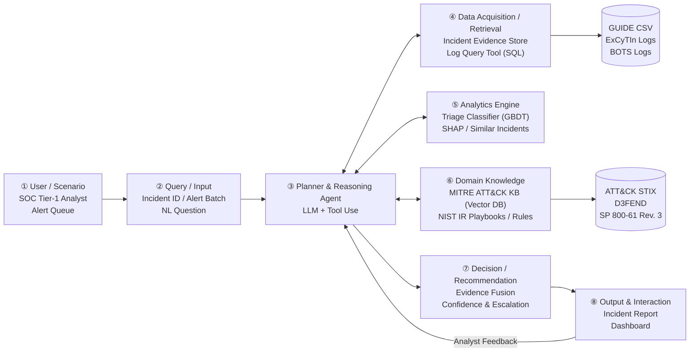

# AI SOC Analyst Agent — DIC3 Project Proposal Refactor using OpenSpec

結合 **ML 告警分級**、**MITRE ATT&CK 領域知識** 與 **LLM 推理** 的資安維運中心（SOC）智慧代理人系統。
Agent 針對資安事件提供 TP / BP / FP 分級、ATT&CK 攻擊鏈對應與處置建議，每個結論皆具備可追溯之證據鏈；當信心不足、結論衝突、高風險或證據不足時，主動升級交由分析師複核。

> **AIOT 課程作業**：DIC3-Project Proposal Refactor using Openspec  
> **學生/提交者**：蕭宥瑄（個人儲存庫呈現，不更動小組原始 Git）  
> **專案小組**：第 16 組（蘇恩平、周妤、袁靖淇、蕭宥瑄）  
> **規範標準**：遵循 2025 AIoT-DA & OpenSpec Spec-Driven Development (SDD) 規格驅動開發治理規範  

---

## 專案規格與文件架構

| 目錄 / 文件 | 說明 |
|---|---|
| [`openspec/`](openspec/) | **OpenSpec 規格驅動開發根目錄**：包含全域配置、基準規格（`specs/`）與提案變更（`changes/`） |
| [`openspec/changes/archive/2026-11-11-01-proposal-workflow-refactor/`](openspec/changes/archive/2026-11-11-01-proposal-workflow-refactor/) | **DIC3 核心變更提案（已歸檔）**：包含 `proposal.md`、`specs/`、`design.md` 與 `tasks.md`（合規檢核表） |
| [`openspec/changes/archive/2026-11-11-align-design-algorithms/`](openspec/changes/archive/2026-11-11-align-design-algorithms/) | **演算法與 DESIGN.md 對齊（已歸檔）**：對齊 Algorithm 1/2 偽代碼與說明，補齊高風險安全重標註規格 |
| [`docs/proposal.md`](docs/proposal.md) | **重構後之完整 Proposal**：A~F 專業摘要、5 大核心、3 大權衡、10 大深度問題、密集編號 Introduction 與 Related Work |
| [`DESIGN.md`](DESIGN.md) | **系統技術設計**：8 大核心元件、Planner 動態決策樹、Algorithm 1/2 虛擬碼、GUIDE 評估計畫 |
| [`startup.sh`](startup.sh) | **營運自動化 - 開發啟動 SOP**：自動拉取更新、驗證 Node/OpenSpec 環境、檢查規格並提示接續工作 |
| [`ending.sh`](ending.sh) | **營運自動化 - 開發交接 SOP**：全面自動執行 `openspec validate`、檢查 Tasks 完成度、自動 Commit 並 Push |

---

## DIC3 核心規範重構重點

### 1. 專業摘要 (A 到 F，約 500 字)
- **【A. Attention Getter】**：引用 2025 年國安局報告（中共每日侵擾關鍵基礎設施 263 萬次，+6%）與 IBM 2026 年報告（資料外洩平均成本達 499 萬美元新高，處理耗時 247 天）。
- **【B. But】**：告警疲勞造成分析師漏看真威脅；五種主流 tool-using LLM 策略漏判率至少 40.4% [3]，查無紀錄時易過早結案。
- **【C. Cure】**：提出 AI SOC Analyst Agent，三方整合 ML 分級、MITRE ATT&CK 知識與 LLM 推理。
- **【D. Development】**：LLM Agent（tool use）、LightGBM（GBDT）、SHAP 特徵解釋、ATT&CK 向量庫（Chroma）檢索、證據融合與主動升級機制、Streamlit 介面。
- **【E. Experiments】**：微軟 GUIDE（100 萬起事件真實標籤）與 ExCyTIn-Bench（SQL 調查日誌），評估 Macro-F1、TP 漏判率、升級率與消融實驗。
- **【F. Expected Outcomes】**：預期 TP 漏判率顯著低於純 GBDT 與純 LLM；量化「漏判率 vs. 升級率」取捨曲線。

### 2. 五大核心（5 Cores）
1. **M1. Assume Breach（假設已遭入侵）**：不預設環境純淨，「查無紀錄」不等於無攻擊；遇到查無紀錄時擴大查詢範圍，預算耗盡仍未確認即觸發升級（對應 Rule R4、Algorithm 1 L05–L09、L18）。
2. **M2. 看事件與攻擊鏈脈絡，而非單一告警**：單一告警意義有限，以事件為核心分析單位實施多層聚合，依攻擊推進階段動態評估威脅進程（對應 Evidence Store、特徵工程、Rules R1–R5）。
3. **M3. 錯誤成本不對稱**：漏判真實攻擊的代價遠高於誤報，以 TP 漏判率為首要指標，高風險情境偏向升級（對應 NFR2、Algorithm 2 L06–L08）。
4. **M4. 看攻擊行為（TTPs），而非容易替換的指標（IOCs）**：以 MITRE ATT&CK 技術作為知識核心單位，避免模型特徵過度依賴單純網路指標（對應 ATT&CK 向量庫、特徵工程）。
5. **M5. 自動化要可驗證，人保留最終判斷**：每個結論皆附帶結構化證據鏈，結論衝突時明確標記並提供「需人工複核」狀態（對應 NFR1、Algorithm 2 L05、Algorithm 1 L18–L19）。

#### 由五大核心推導出的三項系統創新
1. **Multi-source Evidence Fusion（多源證據融合架構）**：結合統計 ML 高吞吐分級能力與 LLM 脈絡推理，克服單一模型缺陷。
2. **Knowledge-Constrained Attack Chain Reasoning（ATT&CK 知識約束）**：實體嵌入 ATT&CK 本體與 NIST SP 800-61 Rev. 3，以高風險規則（Rules R1~R5）進行後段階段硬約束。
3. **Uncertainty-Aware Proactive Escalation（不確定性感知與人機協同升級）**：貫徹 Assume Breach，將「日誌缺失/衝突」視為升級信號，保護分析師免於自動化自滿。

### 3. 三大專業權衡（3 Trade-offs）
- **Trade-off 1**：TP 漏判率 vs. 人工升級率（Miss Rate vs. Escalation Rate）
- **Trade-off 2**：GBDT 統計預測效率 vs. LLM 語意脈絡推理（Statistical ML vs. LLM Context）
- **Trade-off 3**：確定性領域規則硬約束 vs. 自主代理靈活決策（Deterministic Rules vs. Agent Autonomy）

### 4. 十大深度理解細節（10 Details）
涵蓋 Detector 誤報不關閉原因、攻擊者利用「查無日誌」結案之對抗防禦（T1070）、升級門檻 $\tau$ 量化校準、Living off the Land 判別、防範 Data Leakage 切分等 10 大關鍵技術抉擇。

---

## 系統架構圖



---

## 快速上手與營運 SOP

### 1. 環境需求
- **Node.js**：`v24.10.0` 或更高版本（LTS）
- **OpenSpec CLI**：`@fission-ai/openspec`
- **Python**：`3.10+`（資料前處理與評估）

### 2. 開發前啟動腳本
在終端機（Git Bash 或 PowerShell）執行標準化啟動腳本：
```bash
./startup.sh
```
此腳本將自動檢測 Node/OpenSpec 環境、自遠端拉取最新進度，並對現有規格進行合規驗證。

### 3. OpenSpec 規格驗證
您可以隨時驗證所有 OpenSpec 變更與規格是否符合規範：
```bash
openspec validate --all
```
實際輸出：
```text
✓ spec/evidence-fusion
✓ spec/triage-workflow
Totals: 2 passed, 0 failed (2 items)
```

### 4. 開發交接與推送腳本
完成工作或交接時，執行交接腳本自動驗證並推送：
```bash
./ending.sh
```

---

## 組員與權責聲明

- **期末專案分組**：第 16 組（蘇恩平、周妤、袁靖淇、蕭宥瑄）
- **本倉儲說明**：本倉儲為蕭宥瑄依據 DIC3 規範獨立進行 OpenSpec SDD 重構之個人作業展示倉儲，原始小組專案保持完整不受影響。
