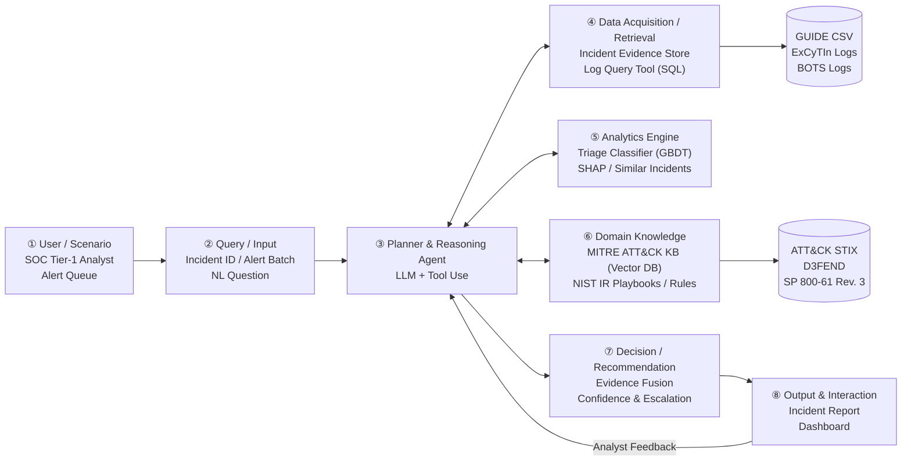
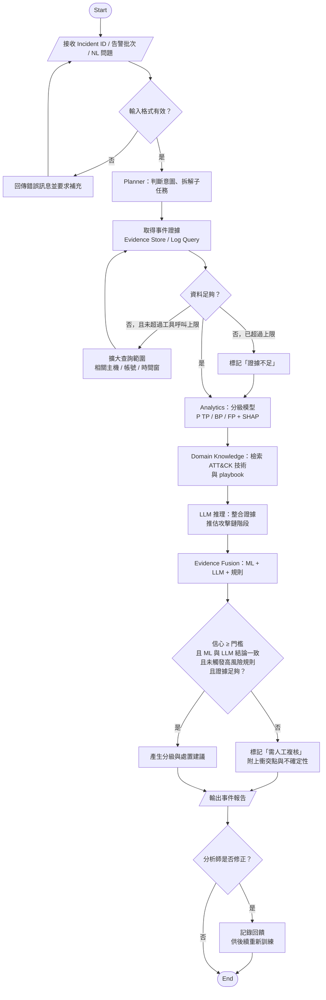

# AI SOC Analyst Agent：結合 MITRE ATT&CK 領域知識與 LLM 推理的資安告警分級代理人

> Final Project Proposal — AIOT
> 第 16 組：蘇恩平、周妤、袁靖淇、蕭宥瑄
> Proposal 階段，2026 年 11 月

---

## 1. Abstract

**【A. Attention Getter】** 資安攻擊的規模與代價持續攀升。國安局報告指出，2025 年中共對我關鍵基礎設施網路侵擾日均約 263 萬次，年增 6% [23]；IBM 2026 年報告顯示，資料外洩全球平均成本創 499 萬美元新高，處理耗時 247 天 [14]。站在第一線的資安維運中心（SOC）每天面對海量告警，真實攻擊僅占極少數 [2]。

**【B. But】** 大量誤報與良性觸發造成告警疲勞，讓分析師可能漏看真正的威脅 [8][24]。現有 ML 分級缺乏攻擊鏈脈絡 [1][7]；LLM 調查代理人漏判率高達 40.4% [3]，查無紀錄時易過早結案 [4]。此外，過度自動化會讓分析師降低監控並產生自滿 [12]。

**【C. Cure】** 為解決上述問題，本專題提出結合 ML 分級、MITRE ATT&CK 領域知識與 LLM 推理的 **AI SOC Analyst Agent**，對資安事件提供有證據、可解釋，且「知道何時該交給人」的分級與處置建議。

**【D. Development】** 系統以 LLM 為推理核心取證；以 GBDT 預測真陽性（TP）、良性陽性（BP）或誤報（FP）機率並由 SHAP 解釋；以向量庫檢索 ATT&CK 與 NIST SP 800-61 Rev. 3 流程；最後經證據融合整合結論，遇信心不足、衝突或高風險時主動升級人工複核。

**【E. Experiments】** 本專題以微軟 GUIDE（約 100 萬起真實事件）評估分級，並以 ExCyTIn-Bench 評估調查能力。比較規則、純 GBDT 與純 LLM，重點評估 Macro-F1、TP 漏判率與升級率，並以消融實驗檢驗各模組貢獻。

**【F. Expected Outcomes】** 本專題尚未進行實驗。預期：（1）整合領域知識與升級後，TP 漏判率低於純 GBDT 與純 LLM baseline；（2）量化呈現漏判率與升級率之取捨曲線；（3）提升 ATT&CK 對應正確性與報告可解釋性。實際結果將於期末報告呈現。

**關鍵字**：Security Operations Center、Alert Triage、LLM Agent、MITRE ATT&CK、Retrieval-Augmented Generation、Human-in-the-loop

### 1.1 Five Cores（五大核心）

本專題根植於資安專家普遍認同的五大核心思維模式（詳見 §4 Q1），並將其具體轉化為系統設計準則：

1. **M1. Assume Breach（假設已遭入侵）**：不預設環境純淨，「查無紀錄」不等於無攻擊，可能是日誌遭清除或範圍不足；系統遇到查無紀錄時不直接結案，而是擴大查詢主機與時間窗，預算耗盡仍未確認即觸發升級（對應 Rule R4、Algorithm 1 L05–L09、L18）。
2. **M2. 看事件與攻擊鏈脈絡，而非單一告警**：單一告警意義有限，嚴重度取決於其在攻擊鏈中的位置與前後序列；系統以事件為核心分析單位實施三層聚合，並依攻擊推進階段動態評估威脅進程（對應 ④ Evidence Store、⑤ 攻擊鏈特徵、⑥ Rules R1–R5）。
3. **M3. 錯誤成本不對稱**：漏判真實攻擊的代價遠高於誤報，但過量誤報亦會引發疲勞；系統以 TP 漏判率為首要指標，並在高風險情境偏向升級，同時呈現漏判與升級取捨（對應 NFR2、Algorithm 2 L06–L08、DESIGN.md §10 E1 評估）。
4. **M4. 看攻擊行為（TTPs），而非容易替換的指標（IOCs）**：IP、Hash 等指標易被置換，攻擊手法難以改變；系統以 MITRE ATT&CK 技術作為知識核心單位，模型特徵避免依賴單純網路指標（對應 ⑥ ATT&CK 向量庫、⑤ 特徵工程）。
5. **M5. 自動化要可驗證，人保留最終判斷**：AI 提高效率但若缺乏檢核將引發自滿；系統每個結論皆附帶結構化證據鏈，結論衝突時明確標記並提供「需人工複核」狀態（對應 NFR1、Algorithm 2 L07–L11、⑧ 報告格式）。

#### 由五大核心推導出的三項系統創新

1. **Multi-source Evidence Fusion — 多源證據融合架構**
   透過 GBDT（LightGBM）快速處理大規模匿名化特徵並產出經校準的 TP / BP / FP 機率分佈與 SHAP 特徵歸因；結合 LLM ReAct 調查代理人動態檢索日誌證據與脈絡推理，克服單一 LLM 漏判與單一 ML 缺乏語意解釋的痛點。
2. **Knowledge-Constrained Attack Chain Reasoning — MITRE ATT&CK 領域知識約束**
   整合 MITRE ATT&CK 向量知識庫與 NIST SP 800-61 Rev. 3 應變指引，建立五大高風險攻擊鏈規則（Rules R1~R5）。依據攻擊推進階段（如 Exfiltration、Lateral Movement）實施硬約束，越後段越傾向升級，打破傳統黑箱模型對攻擊鏈脈絡的漠視。
3. **Uncertainty-Aware Proactive Escalation — 不確定性感知與人機協同主動升級**
   落實 Assume Breach 原則，當模型信心不足、ML 與 LLM 結論衝突、日誌記錄中斷缺失或觸發高風險規則時，主動升級給人工複核並附帶可驗證的證據鏈，量化呈現「TP 漏判率 vs. 人工升級率」的 Pareto 權衡曲線，避免分析師自動化自滿。

**核心研究價值**：從被動式告警過濾（Passive Alert Filtering），邁向具備攻擊鏈脈絡、不確定性感知與人機協作的主動式資安分析代理人（Proactive, Context-Aware, Uncertainty-Guided SOC Analyst Agent）。

### 1.2 Three Key Trade-offs（三大專業權衡取捨）

本專題所聚焦的三大工程權衡取捨，直接對應至資安專家在實務維運中的三大核心專業爭論（詳見 §4 Q2）：全自動 vs. 人機協作、規則式 vs. 機器學習、以及公開基準 vs. 真實環境。

1. **漏判率 vs. 人工升級率（Miss Rate vs. Escalation Rate）**
   - **權衡衝突**：追求 0 漏判率（False Negative Rate = 0）的最簡單方式是將所有告警全部升級給人工，但這會引發嚴重的告警疲勞，導致分析師崩潰；反之，若過度自動結案則會漏放真實勒索軟體或 APT 攻擊。
   - **本專題解法**：在驗證集上繪製「漏判率–升級率曲線」，以可調門檻 $\tau$ 讓 SOC 管理者依當前輪班人力動態配置最優平衡點。
2. **GBDT 統計預測效率 vs. LLM 語意脈絡推理（Statistical ML Efficiency vs. LLM Contextual Reasoning）**
   - **權衡衝突**：GBDT 在 GUIDE 等大規模結構化特徵上推論極快（<10 ms）、成本極低且機率可校準，但無法理解多步驟調查故事；LLM 具備強大跨日誌關聯與文本解釋力，但成本高（AIDA 每告警消耗 3.4 萬 token）、延遲長且有幻覺。
   - **本專題解法**：設計雙軌分工架構，由 GBDT 承擔底層快速機率過濾，LLM 專注於複雜事件之脈絡整合與報告生成，兼顧系統吞吐量與深層可解釋性。
3. **確定性領域規則硬約束 vs. 自主代理靈活決策（Deterministic Rule Constraints vs. Autonomous Agent Flexibility）**
   - **權衡衝突**：過度依賴靜態規則無法因應新型未見攻擊（Zero-day）；而給予 LLM 代理人完全自主權，又經常在日誌回傳為空時過早誤判結案。
   - **本專題解法**：將資安專家常識（如資料外洩已發生、日誌被清除等）固化為高風險警戒規則（Rules R1~R5），作為不可被模型降級的硬護欄，在確保底線安全的前提下發揮代理人的自主探索優勢。

### 1.3 Ten Deep Understanding Details（十大深度理解問題與設計細節）

| # | 核心類型 | 關鍵問題 | 深入理解者核心洞見（技術抉擇依據） | 系統實作映射位置 |
|---|---|---|---|---|
| 1 | **Why** | 某 Detector 誤報率達 90%，為何 SOC 不直接將其關閉？ | 關閉會失去對該 ATT&CK 技術的偵測覆蓋，讓攻擊者隱匿於防禦盲區；應區分 FP 與 BP 後進行白名單或事件級聚合。 | `④ Evidence Store` / `⑤ 特徵工程` |
| 2 | **What-if** | 攻擊者若得知 Agent 在「查無紀錄」時結案會如何應對？如何防禦？ | 攻擊者會刻意清除日誌（T1070 Defense Evasion）；系統必須貫徹 Assume Breach，將「日誌缺失/中斷」視為高風險升級信號。 | `Rule R4` / `Algorithm 1 L05-L09` |
| 3 | **Trade-off** | 升級門檻 $\tau$ 如何量化設定？為何不能盲目追求 0 漏判？ | 漏判與誤報成本不對稱（M3），但人力有限；門檻應基於驗證集 ROC 曲線與 SOC 人力吞吐量設定，而非單看 F1 分數。 | `Algorithm 2 L07` / `DESIGN.md §10 E1 評估` |
| 4 | **Failure Case** | 為何高信心判為 BP 的事件可能是真實攻擊（Living off the Land）？ | 攻擊者濫用系統合法工具（如 PowerShell）時行為與管理員雷同；差異在於「意圖與上下文脈絡」（誰、何時、前後序列）。 | `⑥ 攻擊鏈時序規則` / `SHAP 歸因` |
| 5 | **Evidence** | 如何證明 Agent 在實務上有益，而非僅是在資料集上過擬合？ | 需同時報告漏判率、升級率、報告質量評分（E4），並跨 GUIDE 與 ExCyTIn-Bench 雙重評估以檢驗泛化力。 | `DESIGN.md §10 評估計畫 E1~E5` |
| 6 | **Comparison** | TP、BP、FP 的本質差異為何？為何混淆會破壞防禦？ | TP 是真實惡意；BP 是行為真實但授權無害（需建白名單）；FP 是規則誤觸（需調校規則）；混淆會導致錯誤的工程反饋。 | `①-⑧ 全流程標籤定義` |
| 7 | **Design Decision** | 為什麼分級主力採用 GBDT 而非純 LLM？ | GUIDE 欄位匿名化使 LLM 無法提取語意；GBDT 在巨量結構化數據上推論廉價穩定、機率可校準且支持 SHAP 歸因。 | `⑤ Analytics Engine` |
| 8 | **Real-world** | 凌晨帳號海外登入、設郵件轉寄、大量下載之場景如何處置？ | 識別為 Initial Access → Persistence → Exfiltration 後段攻擊鏈；觸發 R1/R2 直接升級並啟動 NIST SP 800-61 隔離處置。 | `Playbook PB` / `Algorithm 2` |
| 9 | **Why** | MITRE ATT&CK 區分 Tactic 與 Technique 的深層意義為何？ | Tactic 代表攻擊者的戰略意圖（橫向移動、竊取），用於評估威脅進程；Technique 代表具體手法，用於精準偵測與緩解。 | `⑥ ATT&CK 向量資料庫` |
| 10 | **Data Rigor** | 為何 GUIDE 資料集切分嚴禁隨機亂序切分？ | 隨機切分會導致同事件告警或同組織模式滲漏至測試集，嚴重高估模型表現；必須嚴格依 Incident/Org/Time 分組切分。 | `DESIGN.md §5 資料前處理防洩漏設計` |

## 2. Introduction

### 2.1 Attention Getter：攻擊規模攀升與偵測時效瓶頸

**2.1.1 2025–2026 全球與地緣資安威脅加劇**
網路攻擊已從單純技術試探演變為日常的國安與經濟威脅。依我國國安局 2025 年最新資安報告指出，中共對我國關鍵基礎設施的網路侵擾平均每日高達 263 萬次，較 2024 年顯著增加 6% [23]，且攻擊樣態高度分散、隱匿性極強。

**2.1.2 潛伏期延長與外洩成本創歷史新高**
攻擊者一旦入侵成功，往往不會立即觸發告警：Mandiant M-Trends 2026 報告指出，2025 年全球攻擊者在受害環境中的潛伏時間（Dwell Time）中位數為 14 天（較前一年的 11 天更長），而在高度精密的網路間諜活動與北韓 IT 人員偽裝滲透案件中，潛伏期更高達 122 天 [15]。IBM 2026 年最新《Cost of a Data Breach》報告則顯示，全球企業資料外洩的平均成本已創下 499 萬美元的歷史新高（年增 12%），從事件發生到被偵測、圍堵平均耗時 247 天；而高度導入 AI 與自動化防護的組織，平均可節省 193 萬美元損失並縮短 65 天處理週期 [14]。

### 2.2 Background：資安維運中心（SOC）運作機制與 AIoT 跨域挑戰

**2.2.1 SOC 多層防禦體系與告警分流**
資安維運中心（Security Operations Center, SOC）是防禦組織遭受威脅的核心樞紐。端點防護（EDR）、網路閘道、身分認證（IAM）與雲端日誌每天產生海量告警，統一匯流至 SIEM / XDR 平台：
- **Tier-1 分析師（初步分級，Triage）**：承擔第一線壓力，負責判讀告警屬於真陽性（True Positive, TP，真實惡意）、良性陽性（Benign Positive, BP，行為真實但為授權無害）或誤報（False Positive, FP，規則誤觸）。實務研究證實，超過 70% 的所謂「誤報」本質上是良性觸發（BP）[24]。
- **Tier-2 / Tier-3 分析師（深入調查與處置）**：接手重大真實事件，進行取證根因調查、橫向移動圍堵與受害系統災後復原。

**2.2.2 領域標準框架：MITRE ATT&CK 與 NIST SP 800-61 Rev. 3**
分級時，分析師必須依賴 MITRE ATT&CK 框架推估攻擊技術（Technique）與戰術進程（Tactic）[10][22]，並依照美國國家標準與技術研究院 NIST SP 800-61 Rev. 3（2025 年 4 月發布，整合 CSF 2.0 治理框架）[13] 執行事件應變（Incident Response）標準流程。

**2.2.3 與 AIoT 物聯網數據分析之深層連結**
在現代企業與工控環境中，物聯網（IoT）與運營技術（OT）邊緣設備往往因運算資源限制而無法安裝重型端點代理程式（EDR-agentless）。物聯網設備的異常行為（如異常連線、認證暴破、橫向掃描）皆透過網路流量與身分層告警傳入 SOC。本專題採用事件（Incident）層級跨來源關聯，並結合 ATT&CK for ICS 矩陣，能無縫覆蓋物聯網與傳統 IT 的異質告警分級。

### 2.3 Problem：告警疲勞成為 SOC 致命瓶頸

**2.3.1 低信噪比與認知超載**
大型 SOC 每天須處理數萬至數十萬則零散告警，其中對應真實攻擊者不足 5% [2]。面對巨量事件佇列，多數組織只能採用先進先出（FIFO）或靜態嚴重度（Severity）粗暴排序 [7]，導致分析師陷入嚴重的**告警疲勞（Alert Fatigue）**，身心俱疲下極易漏看真正的進階持續性威脅（APT）[8][9]。

**2.3.2 本專題核心研究問題（Core Research Question）**
> **能否設計一個 AI SOC Analyst Agent，深度融合機器學習統計分類、MITRE ATT&CK 攻擊鏈領域知識與 LLM 脈絡推理，對資安告警事件提供「具備證據鏈、高可解釋性，且知道何時該主動交由人審查」的分級與處置建議？**

### 2.4 Existing Limitations：現有五大解法之結構性缺陷

**2.4.1 限制一：傳統 ML 分級缺乏攻擊鏈深層脈絡**
微軟 Copilot Guided Response [1] 與 AIP [7] 證實 ML 具備大規模部署能力，但純統計模型本質上僅比對「特徵向量是否相似於歷史 TP」，無法解釋該行為在攻擊鏈（Kill Chain）中的因果位置 [10][11]。

**2.4.2 限制二：LLM 調查代理人漏判率高且過早結案**
前沿研究指出，五種主流 tool-using LLM 調查策略在資安基準上的攻擊漏判率皆高達 40.4% 以上 [3]；尤其當日誌查詢「查無結果」時，LLM 極易誤判為安全而提前結案；在 ExCyTIn-Bench 實際日誌調查任務中，SOTA 模型的 Reward 僅有 0.606 [4]。

**2.4.3 限制三：資安領域知識未實體嵌入決策系統**
現有 ATT&CK 應用多僅停留在非結構化威脅情資文字對齊（如 TechniqueRAG [6]），而基於攻擊鏈的嚴重度評估則多為手動規則或靜態攻擊圖 [10][11]，未能與動態 ML/LLM 融合。

**2.4.4 限制四：缺乏可驗證性導致人機自動化自滿**
研究顯示，單純提高自動化程度會導致分析師產生「自動化自滿（Automation Complacency）」並喪失警覺 [12]；實地部署實證表明，分析師是否採納 AI 輸出的核心關鍵在於「結論是否容易驗證」[26]。

**2.4.5 限制五：學界基準缺乏實務可重現性與防洩漏設計**
經典資安資料集（如 CICIDS2017）被證實超過 20% 的流量存在合成錯誤與標註瑕疵 [17]；大量論文因隨機亂序切分產生 Data Leakage [16]，評估結果普遍嚴重高估。

### 2.5 Innovation：本專題核心突破點與創新矩陣

**2.5.1 SOTA 橫向技術對比矩陣**

| 評估維度 | 傳統純 ML 分級 [1][7] | 純 LLM 調查代理 [2][3] | 本專題 AI SOC Analyst Agent |
|---|---|---|---|
| **判斷架構** | 單一 LightGBM / XGBoost | 單一或多 LLM 自由推理 | **三方多源證據融合**：GBDT 機率 + LLM ReAct + 攻擊鏈硬規則 |
| **領域知識整合** | 隱含於特徵工程 | 放置於 Context Prompt | **實體向量知識庫 + Kill Chain 階段硬約束**（後段階段強制升級） |
| **不確定性處置** | 固定機率門檻二分 | LLM 信心（容易過度自信） | **Assume Breach 主動升級**：信心不足、結論衝突或日誌缺失時觸發複核 |
| **日誌缺失反應** | 填補固定空值或 0 | 常誤判為「無威脅」直接結案 [3] | **反向視為可疑信號**（T1070 Defense Evasion），擴大查詢或升級 |
| **可解釋性輸出** | SHAP 全域/局部數值 | 自然語言摘要（易有幻覺） | **結構化證據鏈**：原始 Log 引據 + 歷史相似事件 + SHAP + 處置 Playbook |
| **評估指標完整性**| Macro-F1 | 僅看準確率 / Reward | **同時量化報告「TP 漏判率」與「人工升級率」**之 Pareto 取捨 |

**2.5.2 與最接近基準 AIDA [3] 之架構突破**
AIDA 的質疑與裁判完全仰賴 LLM 自行對話，每告警耗費約 3.4 萬 Token，且僅在單一合成資料系列重播；本專題的分級機率直接來自在 100 萬起真實事件（GUIDE）上訓練的 GBDT，LLM 專職於語意整合與異常質疑，並將升級條件固化為可審計規則，兼具極低推論成本與企業級安全性。

### 2.6 Contributions：五大具體研究貢獻

**2.6.1 系統架構貢獻**：設計並實作包含 ① 到 ⑧ 的模組化代理人架構，提供清晰的職責分離與介面合約，支援開源生態無縫擴充。
**2.6.2 決策方法貢獻**：提出演算法 Algorithm 1（SOC Triage Agent）與 Algorithm 2（證據融合與主動升級），將 Assume Breach 與錯誤成本不對稱轉換為嚴謹的數學與規則邏輯。
**2.6.3 實證評估貢獻**：於 GUIDE（百萬級實證資料）與 ExCyTIn-Bench（完整 SQL 調查環境）雙重公開基準上驗證，實施嚴格防洩漏切分，並透過消融實驗量化各模組獨立增益。
**2.6.4 領域知識貢獻**：系統化整理 SOC 領域五大思維模式、三大爭論與十大核心問題，搭建學術演算法與工業現場維運實務的橋樑。
**2.6.5 規範治理貢獻**：導入 OpenSpec 規格驅動開發（SDD），提供完整變更規格、測試場景與標準化自動營運腳本（`startup.sh`、`ending.sh`），提升成果的可重現性。

## 3. Related Work

> 本節文獻共 16 篇：AI Technology 8 篇（[1]–[7]、[26]）、Domain Know-how 8 篇（[8]–[13]、[24]、[25]）。
> Limitation 欄位標示「作者自述」者取自原文的限制章節；其餘依原文內容整理。

### 3.1 AI Technology（人工智慧技術領域）

**3.1.1 [1] Copilot Guided Response (CGR) 與 GUIDE 資料集 (Microsoft, 2024)**
- **研究亮點**：微軟整合於 Defender XDR 的工業級 ML 架構，同時處理調查、分級（TP/BP/FP）與處置建議。公開了全球最大的真實 SOC 資料集 GUIDE（1,300 萬證據、160 萬告警、100 萬事件、6.1k 組織）。
- **【作者自述限制】**：模型未與外部學術模型或第三方商用方案進行橫向對比；只能針對既有偵測器規則產生的告警給出建議，無法處理 Zero-day 或未受監控的攻擊途徑。
- **【本專題突破策略】**：本專題以 GUIDE 作為分級模型基準，但不依賴微軟內部黑箱特徵，而是額外引入公開的 MITRE ATT&CK 向量本體與 Kill Chain 規則約束，彌補純 ML 缺乏攻擊進程解釋力的缺點。

**3.1.2 [7] Alert Incident Prioritization (AIP, Microsoft, 2026)**
- **研究亮點**：將資訊檢索 BM25 概念創新改寫為免查詢、跨租戶的事件佇列排序演算法，在 1,000 個組織的專家評估中達到 92.8% Precision@10，並在 GUIDE 上補齊 9,980 個事件的優先排序標籤。
- **【作者自述限制】**：僅負責對既有佇列進行相對優先順序排序，本質上不負責判斷告警究竟是 TP、BP 還是 FP；且極度依賴 ATT&CK 對應、威脅情資與資產標籤等元資料的完整性。
- **【本專題突破策略】**：本專題將 AIP 的佇列排序概念與端到端分級推理整合，不僅給出排序，更由證據融合模組精確判定 TP/BP/FP 並輸出人機升級決策。

**3.1.3 [2] CORTEX: Multi-Agent LLM Investigation (2025)**
- **研究亮點**：針對單一 LLM 面對企業日誌雜訊時表現不穩的弱點，提出行為分析、證據蒐集與推理的多 Agent 協同架構，使可行動告警 F1 提升至 0.78，誤報率由 24.9% 降至 14.2%。
- **【作者自述限制】**：評估情境數有限；系統對日誌分布偏移、Prompt Injection 攻擊以及工具回傳不完整高度敏感；Token 消耗量達單 Agent 的 5.7 倍，每告警平均耗時長達 152 秒。
- **【本專題突破策略】**：本專題改由 GBDT 承擔高頻率的大規模特徵過濾，僅在需要複雜上下文關聯時啟動 LLM ReAct 調查，並設立工具呼叫上限與 Token 預算 $B$，嚴格控制推論延遲與營運成本。

**3.1.4 [3] AIDA: Multi-Agent Challenge and Judge (Tsegai et al., 2026)**
- **研究亮點**：系統性評估 5 種 tool-using LLM 推理策略，揭露現有方法漏判率高達 40.4% 且常在查無紀錄時過早結案；提出 AIDA 質疑與裁判機制，將漏判率降至 3.1%（代價為 18.4% 升級率）。
- **【作者自述限制】**：實驗僅基於 AIT-LDSv2 單一合成資料系列重播；缺乏組織脈絡（帳號角色、資產價值）時仍無法精準定性；推理、質疑與裁判均由 LLM 完成，每告警消耗 3.4 萬 Token，成本偏高。
- **【本專題突破策略】**：本專題引入真實分析師標註的 GUIDE 資料集；將分級主力交由 GBDT 輸出校準機率，LLM 不單獨掌握生殺大權；將升級條件實體化為可檢查的硬性規則（Rules R1~R5）。

**3.1.5 [4] ExCyTIn-Bench: Threat Investigation Benchmark (Microsoft, 2026)**
- **研究亮點**：在受控 Azure 租戶中建置 57 張日誌表、8 條真實攻擊鏈與 7,542 道自動生成題目，為 LLM Agent 提供目前最嚴謹的 SQL 日誌調查多步推理基準。
- **【作者自述限制】**：環境僅限單一虛構企業租戶，背景良性雜訊由模擬生成；評估題目由 LLM 依告警圖反向生成，導致題目分布過度偏重告警表，未能完全反映野外真實日誌複雜度。
- **【本專題突破策略】**：本專題將 ExCyTIn-Bench 作為調查推理能力（E3、E5）的專用測試床，與大規模實證資料集 GUIDE 互為補充，兼顧「標籤真實性」與「調查多步性」。

**3.1.6 [5] CyberSOCEval (Meta, 2025)**
- **研究亮點**：針對惡意程式逆向分析（609 題）與威脅情資推理（588 題）建立基準，發現前沿推理模型在資安領域的進展顯著落後於數學與程式碼，且 Test-time Scaling 效益有限。
- **【作者自述限制】**：惡意程式評估僅限於 Windows 平台；題型皆為選擇題；尚未涵蓋動態事件應變（Incident Response）與現場分級場景。
- **【本專題突破策略】**：本專題不局限於靜態選擇題，而是透過 ReAct 代理人動態串接日誌查詢與 ATT&CK 向量檢索，評估動態生成分析報告與處置建議的實戰能力。

**3.1.7 [6] TechniqueRAG: Threat Intelligence Mapping (2025)**
- **研究亮點**：利用檢索增強生成（Retriever + 微調 LLM + 零樣本重排序）技術將非結構化威脅情資文字對齊至 MITRE ATT&CK 技術，少量標註即可達到 91.09% F1-score。
- **【作者自述限制】**：訓練資料多為單標籤，模型極少預測超過 2 個技術，多標籤場景召回率低；且僅處理威脅情報非結構化文字，無法直接處理 SOC 結構化告警與半結構化日誌。
- **【本專題突破策略】**：本專題建置專屬向量知識庫，將 STIX 2.1 本體、偵測邏輯與緩解措施多粒度切塊，並透過規則映射直接支援告警事件中的複合技術標籤提取。

**3.1.8 [26] Field Deployment of LLM Agents in Higher-Ed SOC (Banstola et al., 2026)**
- **研究亮點**：在真實大學 SOC 進行長達 14 個月的縱向實地研究，證實分析師在超過 90% 的工單中採納 Agent 輸出，為資深分析師節省 30–50% 處理時間；發現「可驗證性（Verifiability）」是決定採用的第一要素。
- **【作者自述限制】**：研究場域僅限單一大學 SOC；時間節省數據依賴分析師自陳回報；為預印本研究。
- **【本專題突破策略】**：汲取其人因洞見，本專題在系統輸出端設計嚴格的「證據鏈（Evidence Chain）」，每個結論均關聯至原始資料來源、SHAP 重要特徵與歷史相似事件，確保輸出極度易於人類複核。

### 3.2 Domain Know-how（資安領域專業知識）

**3.2.1 [8] Survey on AI-based Alert Filtering (Ndichu et al., 2026)**
- **核心洞見**：系統性回顧 2015–2026 年 87 篇告警篩選核心研究，歸納出過濾、分級、關聯與生成式增強四階段架構，並直指領域長期欠缺實際營運驗證、對抗穩健性、跨環境泛化與評估方法一致性。
- **【作者自述限制】**：僅納入英文文獻；多數被回顧論文依賴 CICIDS、DARPA TC 等傳統合成資料集，量化評估結果可能嚴重高估。
- **【本專題轉化設計】**：本專題直接回應其指出的「評估一致性」缺口，全流程採用 GUIDE 與 ExCyTIn-Bench 雙重公開實證基準，並遵守無洩漏分割規範。

**3.2.2 [9] LLM-for-SOC Comprehensive Survey (Habibzadeh et al., 2025)**
- **核心洞見**：全面梳理 LLM 於 SOC 各階段的整合潛力，總結告警海量、人力短缺、專家培育週期長與回應延遲四大結構性困境。
- **【作者自述限制】**：純文獻綜述性質，缺乏具體系統實作與定量實驗對比。
- **【本專題轉化設計】**：本專題將其理論框架落地為具體可執行的 OpenSpec 八大元件架構與演算法實作。

**3.2.3 [10] Kill Chain Attack Graph Mapping (Sadlek et al., 2025)**
- **核心洞見**：以 MITRE CALDERA 建立攻擊圖，證實將告警序列映射至 ATT&CK Kill Chain 最遠推進階段與資產重要性，序列分類 AUC 可達 0.95。
- **【作者自述限制】**：測試環境規模小（10 台主機），缺乏背景使用者干擾；MulVAL 攻擊圖規則需專家高度手動維護，在大型網路難以擴展。
- **【本專題轉化設計】**：本專題揚棄手動繪製靜態全網攻擊圖，改以輕量級「高風險攻擊鏈規則（Rules R1~R5）」動態評估事件戰術覆蓋，兼顧計算效率與威脅進程感知。

**3.2.4 [11] ROSCA: Explainable Alert Graph Aggregation (Al-Shaer et al., 2025)**
- **核心洞見**：在法國真實醫院 SOC 部署動態圖關聯，將零散告警聚合成 Case 並依戰術推進計分，耗時僅 0.12 秒，大幅降低分析師認知負荷。
- **【作者自述限制】**：資料規模小（醫院兩個月 382 筆告警），未報告 Precision/Recall 傳統指標，僅適用於能明確推導戰術之告警。
- **【本專題轉化設計】**：本專題借鑑其「以 Case / Incident 為聚合單位」之原則，在數據處理層即以 Incident 進行多層聚合，避免孤立評估單一告警。

**3.2.5 [12] Automation Complacency and Bias in SOCs (Tilbury & Flowerday, 2026)**
- **核心洞見**：調查 696 名分析師證實自動化程度提高會顯著引發「自動化自滿（Automation Complacency）」，分析師會降低批判性監控；而「系統性驗證程序」可有效緩解此現象。
- **【作者自述限制】**：研究樣本集中於美國 SOC；數據主要來自自陳式問卷。
- **【本專題轉化設計】**：本專題堅決不採用「靜默自動結案」架構，而是設立明確的「需人工複核」狀態與衝突標註機制，強制呈現證據衝突點，引導分析師進行實質審查。

**3.2.6 [13] NIST SP 800-61 Rev. 3 Incident Response Standard (NIST, 2025)**
- **核心洞見**：全面整合 CSF 2.0 六大功能，強制規範資安事件必須實施嚴格的分級與驗證程序（RS.MA-02），明令禁止依照先到先處理（FIFO）的粗暴佇列方式處置。
- **【作者自述限制】**：國家級高階治理原則指引，並未給出具體特徵工程、門檻值公式或演算法細節。
- **【本專題轉化設計】**：本專題將 NIST 規範轉化為具體的處置建議 Playbook 模組，由決策引擎依事件分級與 ATT&CK 階段自動匹配對應之遏阻（Containment）與復原措施。

**3.2.7 [24] Understanding Real-World False Positives vs Benign Triggers (Alahmadi et al., 2022)**
- **核心洞見**：深入訪談 21 名 SOC 人員，實證揭露業界俗稱的「誤報」極大比例本質上是「良性陽性（Benign Positive, BP）」，二者在防禦調校上具有根本差異（BP 需建白名單，FP 需改規則）。
- **【作者自述限制】**：樣本規模偏小（7 所歐洲 SOC）；依賴質性訪談。
- **【本專題轉化設計】**：本專題將標籤體系嚴格確立為三分類（TP / BP / FP），拒絕傳統二元簡化分類，並針對 BP 與 FP 提供截然不同的後續反饋調校路徑。

**3.2.8 [25] Think-Aloud Empirical Investigation of Tier-1 Triage (Kersten et al., 2025)**
- **核心洞見**：以放聲思考法實測 400 次調查，發現最終需要升級的重大告警，分析師會跨維度蒐集顯著更多樣的證據實體。
- **【作者自述限制】**：受測者多為初階實習分析師；部分攻擊場景重複出現。
- **【本專題轉化設計】**：本專題設計 ReAct 調查代理人的動態擴展機制（Algorithm 1 L05-L09），在識別出潛在升級信號時主動跨帳號、主機與時間窗廣泛蒐集證據。

### 3.3 Article Summary Table

| Ref. | Year | Problem | AI Method | Domain Knowledge | Dataset | Findings | Limitation |
|---|---|---|---|---|---|---|---|
| [1] | 2024 | SOC 事件的調查、分級、處置建議 | ML 架構（CGR），整合於 Defender XDR | SOC triage（TP/BP/FP）、處置動作 | GUIDE（1,300 萬證據、160 萬告警、100 萬事件、6.1k 組織、兩週，公開） | 已部署至數千客戶、產生數百萬筆建議；以內部資料離線評估，分級跨區域平均 macro-F1 0.87、precision 0.87、recall 0.86；在 90% precision 的門檻下，分級模型可覆蓋約 41% 的事件（GUIDE 本身未報告分級分數） | 作者自述：未與其他模型或商用產品比較；只能針對既有偵測器給建議，無法處理 zero-day 或未監控的攻擊途徑 |
| [2] | 2025 | 告警量大、單一 LLM 雜訊下不穩且不透明 | 多 Agent LLM（行為分析、證據蒐集、推理） | SOC 調查流程、分析師逐步行動 | 自建並公開的 SOC 調查軌跡（10 餘個真實企業情境、數千筆） | 相較使用工具的單 Agent：可行動告警 F1 0.66 → 0.78，誤報率 24.9% → 14.2% | 作者自述：情境數有限；對分布偏移、prompt injection、工具回傳不完整敏感。成本：token 約 5.7 倍、每告警 152 秒（約 3.4 倍） |
| [3] | 2026 | LLM Agent 的推理策略如何影響證據蒐集與結案時機 | 5 種 tool-using LLM 策略；提出 AIDA（多 Agent 質疑 + Judge） | 告警分級、SIEM 調查 | ALERT-BENCH：以 AIT-LDSv2 telemetry 在 SIEM 重播；1,247 筆告警，來自四天的多階段攻擊情境 | 現有方法漏判 ≥ 40.4%，且查無紀錄時最易誤判結案；AIDA F1 0.958、漏判率 3.1%，升級 18.4%；每告警約 3.4 萬 token、12.7 秒、0.109 美元（GPT-4.1） | 作者自述：資料僅來自 AIT 同一資料系列，未在獨立收集的 SOC 資料上驗證；缺乏組織脈絡（帳號角色、資產用途）時部分事件仍無法判斷；未評估分析師實際使用情形；預印本 |
| [4] | 2026 | 缺乏評估 LLM Agent 威脅調查能力的 benchmark | LLM Agent + SQL 工具；由調查圖自動生成題目 | 資安 log、調查圖、偵測邏輯 | 單一受控 Azure 租戶（虛構公司）：57 張 log 表、8 條真實攻擊鏈、7,542 題 | 最佳模型 reward 0.606；改用完整資料庫降至 0.248；移除告警表後表現明顯下降 | 依內文整理（無獨立限制章節）：僅一個租戶，良性雜訊為模擬產生；題目由 LLM 依告警圖生成，偏重告警表 |
| [5] | 2025 | 惡意程式分析與威脅情資推理缺乏 benchmark | LLM 評估（含推理模型） | 惡意程式分析、威脅情資 | CyberSOCEval（CyberSecEval 4 的一部分）：惡意程式分析 609 題、威脅情資推理 588 題（45 份報告） | 各模型準確率約 23–34%（惡意程式）、43–53%（威脅情資），遠未飽和；模型越大越新越好；test-time scaling 在資安的效益不如程式與數學 | 作者自述：惡意程式分析只涵蓋 Windows；皆為多選題；事件應變與分級列為未來工作，尚未涵蓋 |
| [6] | 2025 | 從資安文字辨識 ATT&CK 技術，需大量標註 | RAG：retriever + 指令微調 LLM + 零樣本重排序 | MITRE ATT&CK 技術 | Tram、Procedures、Expert 三個 benchmark（分別涵蓋 198、488、290 種技術） | 少量標註即達 SOTA：Procedures F1 91.09%；多標籤的 Expert 僅約 50%（GPT-4o + RAG 51.30% 略高） | 作者自述：許多技術缺乏程序範例；訓練資料多為單一標籤，模型很少輸出超過兩個技術，多標籤召回率低；標準答案本身不一致。另：僅處理威脅情資文字，而非告警或 log |
| [7] | 2026 | 事件佇列依時間或粗略嚴重度排序，優先順序不明 | 改良 BM25 的跨租戶排序 + 元件層級解釋 | SOC 佇列管理、領域先驗 | 1,000 個組織專家評估；47.3 萬個組織日佇列的上線後紀錄；GUIDE + 9,980 筆排序標籤（499 個佇列） | Precision@10 92.8%；告警細節檢視比嚴重度排序多 17.5% | 作者自述：只排序既有佇列，不判斷 TP/FP，也無法找出未成為事件的攻擊；排序品質依賴 ATT&CK 對應、威脅情資與資產標籤等 metadata 的完整性 |
| [8] | 2026 | 告警疲勞的 AI 解法缺乏系統性整理 | 綜述：過濾、分級、關聯、生成式增強 | 告警疲勞、SOC 工作流程 | 119 筆文獻，其中 87 篇核心研究（2015–2026） | 提出四階段分類；指出營運驗證、對抗穩健性、跨環境泛化與評估方法四項缺口，並提出「Cognitive SOC」研究議程 | 作者自述：排除非英文文獻；多數研究以 CICIDS、DARPA TC 等 benchmark 評估，量化結果應視為上限；為投稿 ACM Computing Surveys 的預印本 |
| [9] | 2025 | LLM 如何整合進 SOC 工作流程 | 綜述：LLM 用於 log 分析、告警分級、威脅情資 | SOC 的人力、告警量、回應時間問題 | 依 Kitchenham 系統性文獻回顧方法整理的文獻 | 作者自稱為第一篇全面探討 LLM 在 SOC 應用的綜述；依 SOC 工作流程分類各項應用 | 無實證結果（綜述性質）；預印本 |
| [10] | 2025 | 多步驟攻擊的告警需依嚴重度分級 | 攻擊圖比對（MulVAL），非 LLM | Kill Chain、ATT&CK、資產重要性 | 10 台主機的測試平台，以 MITRE CALDERA 執行 5 個攻擊情境（31 種 ATT&CK 技術）；475 條告警序列中 10 條為惡意 | 告警序列分類 AUC 0.95；門檻可正確分出 80% 惡意序列 | 作者自述：測試平台規模小、無真實使用者流量；攻擊圖在大型網路有擴展性問題；MulVAL 規則需人工撰寫，維護成本高 |
| [11] | 2025 | 告警量大造成分析師疲勞；SOC 依賴黑箱商用方案，難以理解與自行調整 | 非 ML：依共享欄位建立動態告警圖，聚合成 case，再依 ATT&CK 戰術推進評分（輕量、可解釋） | ATT&CK 戰術推進（Kill Chain） | 法國醫院 SOC：EDR 告警（2 個月、382 筆）與內部 IDS 告警（15 天、37 筆），以分析師人工標籤評估；另含滲透測試資料 | 分數比 MATE 更符合分析師標籤，分析師確認分數有用；382 筆告警的關聯只需 0.12 秒、1.45 MB | 單一醫院、告警數量少；以分數與標籤的對應圖呈現，未報告 Precision / Recall 等量化指標；只納入能確定推得戰術的告警 |
| [12] | 2026 | SOC 自動化是否造成分析師自滿與偏誤 | 非 AI 方法：PLS 結構方程模型 | 自動化自滿與偏誤、人機信任 | 4 次 SOC 觀察、696 份問卷、29 場訪談 | 分析師降低監控、更依賴自動化；系統性驗證程序可減緩 | 僅美國分析師；自陳資料 |
| [13] | 2025 | 事件應變指引需與 CSF 2.0 整合 | — | 事件應變生命週期（CSF 2.0 六大功能） | — | 取代 2012 年 Rev. 2；建議事件須先分級與驗證（RS.MA-02），且不應依先到先處理 | 以 CSF 成果與建議呈現的高階指引，不提供告警層級的判斷規則或門檻 |
| [24] | 2022 | 安全工具誤報率高，但「誤報」的定義含糊 | 非 AI 方法：問卷（n = 20）＋半結構式訪談（n = 21） | 分析師如何驗證告警、誤報與 benign trigger 的區別 | 7 個 SOC 的實務人員，多數位於英國 | 多數「誤報」其實是 benign trigger，應與真正的誤報分開衡量；告警的主要問題是不可靠、無法客製、缺乏解釋與脈絡；提出 REACT 模型 | 作者自述：樣本小、僅 7 個 SOC 且多在英國與歐洲；非隨機招募；自陳資料 |
| [25] | 2025 | Tier-1 分析師實際如何調查告警，所知甚少 | 非 AI 方法：兩次 think-aloud 實驗，並開發調查輔助系統（AISS） | Tier-1 調查流程、會蒐集哪些資訊 | 一家商業 SOC：5 名分析師 400 次調查；另 4 名分析師使用 AISS 進行 36 次調查 | 調查流程因人、因告警類型而異；需要升級的告警會蒐集更多種類的資訊；AISS 讓分析師以更少動作取得更多相關資訊 | 作者自述：僅一家 SOC，受試者多為實習的初階分析師；同一攻擊被重複調查 |
| [26] | 2026 | LLM Agent 在真實 SOC 中是否會被採用 | LLM ReAct Agent，與分析師共同設計 | SOC 工單處理流程、分析師的信任與採用 | 一所大學 SOC 的 14 個月實地研究，最後 4 個月由分析師實際使用 | 超過 90% 的情況下輸出被用於結案報告；可驗證性是採用的關鍵；最常使用的 3 位分析師估計節省 30–50% 處理時間 | 作者自述：僅一所大學 SOC；時間比較的對照為分析師自陳的手動處理時間；預印本 |

### 3.4 Research Gap

**Existing Research**
- **ML 分級**（[1]、[7]）：可大規模部署、準確，但依賴廠商內部資料，攻擊鏈脈絡沒有明確納入推理。
- **LLM Agent**（[2]、[3]、[4]）：能調查與解釋，但漏判率高（[3] 中現有方法 ≥ 40.4%）、benchmark 分數有限（[4] 最佳 0.606）。
- **知識整合**（[6]、[10]、[11]）：ATT&CK / Kill Chain 能有效判斷嚴重度，但多為規則或圖方法，或只處理威脅情資文字，沒有和 ML 分級、LLM 推理整合。
- **SOC 實務與人因研究**（[12]、[24]、[25]、[26]）：自動化會讓分析師降低監控；分析師需要可解釋、有脈絡、容易驗證的輸出；需要升級的告警需要更多樣的證據。

**Limitations**
1. ML 方法擅長「判斷像不像」，但很少說明「在攻擊鏈中代表什麼」。
2. LLM Agent 在證據不足時容易過早結案，且單純增加推理量不會改善可靠性（[3]）。
3. 多數系統只輸出結論，缺少「何時該交給人」的明確設計，也不容易讓分析師驗證，容易加劇自動化自滿（[12]、[26]）。
4. 綜述 [8] 指出評估方法不一致、缺乏可重現的公開評估。

**Research Gap**
目前缺少一個**同時整合「真實標籤上訓練的 ML 分級」、「ATT&CK / Kill Chain 領域推理」與「LLM 證據整合」**，並以**明確的升級機制**處理不確定性與證據不足、且**在公開資料上可重現評估**的 SOC Agent。

**Our Project**
本專題提出 AI SOC Analyst Agent：
- 以 GUIDE 訓練 ML 分級模型，負責大量、穩定的機率判斷，不讓分級只依賴 LLM（回應 Limitation 2）。
- 以 ATT&CK 知識庫與 Kill Chain 規則提供領域推理，越後段的攻擊鏈階段越傾向升級（回應 Limitation 1）。
- 以證據融合與衝突偵測決定是否交給人工，並把「TP 漏判率」與「升級率」同時列為指標，明確呈現兩者的取捨（回應 Limitation 2、3）。
- 每個結論都附上證據鏈與資料來源，讓分析師容易驗證，而不是只能照單全收（回應 Limitation 3）。
- 以 GUIDE 和 ExCyTIn-Bench 兩個公開資料集評估，確保可重現（回應 Limitation 4）。

## 4. Deep Research

> 本節回答作業要求的三個問題：Q1 SOC 專家普遍認同的五個核心思維模式；Q2 三個最重要的專業爭論；Q3 用來分辨「真正理解」和「死記硬背」的十個問題。
> 每個思維模式和爭論都對應到本專題的具體設計決策。

### Q1. 五個核心思維模式

#### M1. Assume Breach：假設已遭入侵

- **意義**：不要預設環境是乾淨的。「查不到可疑紀錄」不等於「沒有攻擊」，也可能是攻擊者刪了 log、或是查詢範圍不夠。
- **證據**：
  - M-Trends 2026 [15]：2025 年攻擊者在環境中的全球潛伏時間中位數為 **14 天**（前一年 11 天）；網路間諜與北韓 IT 人員案件更長達 **122 天**。
  - NIST Zero Trust Architecture [21] 的基本假設是：企業網路內的資產應「隨時假設攻擊者已存在於網路中」，不因位於內部而被信任。
  - [3] 的實驗發現：LLM Agent **在查詢沒有回傳紀錄時，最容易把攻擊告警誤判為無害並結案**。
- **對系統設計的影響**：Agent 遇到「查無紀錄」時不可直接判為 BP / FP，而是擴大查詢範圍（相關主機、帳號、時間窗）；用完工具呼叫預算仍無法確認，就升級給人工（Flowchart 的「資料足夠？」迴圈；Algorithm 1 第 05–09、18 行）。

#### M2. 看事件與攻擊鏈脈絡，而非單一告警

- **意義**：單一告警本身的意義有限。同樣是「執行 PowerShell」，單獨出現可能是管理員作業；如果接在可疑登入之後、又接著大量外傳資料，就是攻擊鏈的一部分。
- **證據**：
  - [10] 把告警序列對應到 Kill Chain 攻擊圖，以攻擊推進到的最遠階段判定嚴重度，分類 AUC 達 0.95。
  - [11] ROSCA 以 ATT&CK Kill Chain 聚合告警，排序準確度優於 MATE 框架。
  - GUIDE [1] 的分級標籤本身就是標在**事件（incident）層級**，而不是單一告警。
- **對系統設計的影響**：分析單位是「事件」而非「告警」（Evidence → Alert → Incident 三層聚合）；特徵包含 ATT&CK Tactic 覆蓋數與攻擊鏈階段；攻擊推進到後段（例如 Exfiltration）時觸發高風險規則。

#### M3. 錯誤成本不對稱：漏判比誤報昂貴，但誤報也有代價

- **意義**：漏掉一個真實攻擊（False Negative）的代價遠高於多看一個誤報；但誤報太多會造成告警疲勞，反過來讓分析師漏看真正的攻擊。兩者都要管理，不能只看準確率。
- **證據**：
  - IBM 2026 [14]：資料外洩的全球平均成本為 **499 萬美元**，從發生到偵測、圍堵的平均週期為 **247 天**；大量使用 AI 與自動化的組織平均節省 **193 萬美元**、週期縮短 **65 天**。
  - [8] 指出告警疲勞是 SOC 的結構性問題；[3] 顯示降低漏判（40.4% → 3.1%）需要付出 18.4% 升級率的代價。
- **對系統設計的影響**：TP 漏判率是首要指標（NFR2）；Algorithm 2 第 06–08 行在高風險情境下偏向升級；實驗同時報告「漏判率」與「升級率」，明確呈現取捨。

#### M4. 看攻擊行為（TTPs），而非容易替換的指標（IOCs）

- **意義**：IP、網域、檔案 hash 這類指標，攻擊者很容易更換；攻擊手法（Tactics, Techniques, Procedures）則難以改變。這是 Pyramid of Pain [20] 的核心概念，也是 MITRE ATT&CK [22] 以「攻擊者行為」為單位建構知識庫的原因。
- **證據**：
  - Pyramid of Pain [20]：越往上層（TTPs）偵測，攻擊者要付出的代價越高。
  - M-Trends 2026 [15]：初始入侵途徑中，漏洞利用占 32%、語音釣魚占 11%、先前已入侵占 10%，而電子郵件釣魚降到 6%。攻擊手法持續變化，只比對已知指標不足以應對。
- **對系統設計的影響**：以 ATT&CK 技術作為領域知識的核心單位（⑥ Domain Knowledge）；分級模型避免過度依賴 IP、hash 這類容易變動的特徵，以免學到捷徑。

#### M5. 自動化要可驗證，人保留最終判斷

- **意義**：AI 可以加速分級，但分析師必須能理解並檢查 AI 的依據；如果分析師只會照單全收，系統反而會變得更危險。
- **證據**：
  - [12]（696 份問卷、29 場訪談）：自動化程度提高後，分析師降低監控、更依賴自動化結果；**系統性的驗證程序**能減緩這個現象。
  - [18]（720 份問卷）：分析師偏好「全人工」或「全自動」兩個極端，對中間的協作模式興趣不高，使人機協作更難推行。
  - [26]（14 個月實地部署）：分析師是否採用 AI 的輸出，關鍵在於**是否容易驗證**，而不只是準確率。
  - NIST SP 800-61 Rev. 3 [13] 把事件應變放在組織治理（Govern）與風險管理之下，責任仍在組織與人身上。
- **對系統設計的影響**：每個結論都附上證據鏈與來源（NFR1）；ML 與 LLM 結論衝突時明確標示衝突點，而不是只給一個答案；設置「需人工複核」狀態，並在報告中說明為什麼需要人看。

### Q2. 三個最重要的專業爭論

#### 爭論 1：全自動 AI SOC ↔ 人機協作（AI 輔助分析師）

| | 觀點 A：應走向全自動 AI SOC | 觀點 B：AI 只能輔助，人必須在迴圈內 |
|---|---|---|
| **主張** | 告警量已超過人力負荷，只有自動化才能跟上 | 現階段 AI 在資安推理上仍不可靠，全自動會放大錯誤 |
| **最有力證據** | IBM 2026 [14]：大量使用 AI 與自動化的組織平均節省 193 萬美元、週期縮短 65 天；Microsoft 已在大規模環境部署 ML 分級與排序 [1][7] | [3]：五種 LLM Agent 策略都漏判 ≥ 40.4% 的攻擊告警；[4] 最佳模型 reward 只有 0.606；[5] 指出 LLM 遠未達到 benchmark 上限；[12] 顯示自動化會造成分析師自滿 |

- **目前共識**：由 AI 處理大量、低風險、高信心的告警，高風險或不確定的事件交給人判斷；AI 的價值在於「縮短調查時間、提供依據」，而非取代決策。[3] 的 AIDA 與 [2] 的 CORTEX 都在不確定時把告警升級給人；[26] 的實地部署中，Agent 只提供分析，結案仍由分析師決定。
- **尚未解決的問題**：
  1. 升級門檻要怎麼校準？[3] 的 AIDA 用 18.4% 的升級率換取 3.1% 的漏判率，這個比例在不同規模的 SOC 是否可接受？
  2. AI 判錯時責任歸屬為何？
  3. 分析師本身偏好「全人工」或「全自動」兩極 [18]，中間的協作模式要如何設計才會被採用？
- **本專題的立場**：採觀點 B 的人機協作，但用 ML 處理大量判斷以回應觀點 A 的效率需求；實驗同時報告漏判率與升級率，讓取捨可被量化討論。

#### 爭論 2：規則式偵測（Detection Engineering）↔ 機器學習

| | 觀點 A：規則式偵測與分級 | 觀點 B：ML / AI 驅動的偵測與分級 |
|---|---|---|
| **主張** | 規則透明、可稽核、可直接對應 ATT&CK，誤報可透過調校控制 | 規則無法涵蓋未知攻擊，維護成本隨規模爆炸；ML 能從大量資料中學到人寫不出來的模式 |
| **最有力證據** | Sommer & Paxson [19] 指出 ML 用於入侵偵測有根本困難：錯誤成本高、偵測結果與語意之間有落差、網路流量本身高度多樣；Arp 等人 [16] 分析 30 篇頂級會議論文，發現 ML 資安研究普遍存在評估陷阱；[10]、[11] 以 Kill Chain 規則與攻擊圖就能有效排序 | [1]、[7] 的 ML 分級與排序已在數千個組織部署；[8] 回顧 87 篇研究，AI 告警篩選是持續成長的方向 |

- **目前共識**：混合式架構。已知攻擊用規則偵測，ML 用來排序、分級與降低誤報，規則與領域知識則作為 ML 的約束與解釋。[8] 把 AI 告警篩選定位為偵測器產生告警之後的下游工作；[1]、[7] 的 ML 分級與排序也都建立在既有偵測器的告警之上。
- **尚未解決的問題**：
  1. **對抗穩健性**：攻擊者可以刻意讓行為看起來像良性活動，[8] 將此列為主要缺口。
  2. **概念漂移**：模型上線後環境與攻擊手法改變，多久需要重新訓練？
  3. **跨環境泛化**：在 A 公司訓練的模型能否用在 B 公司？[8] 同樣列為缺口。
- **本專題的立場**：混合式。ML（GBDT）負責機率判斷，Kill Chain 規則提供硬性約束（Algorithm 2 第 06–08 行），LLM 負責整合與解釋。

#### 爭論 3：公開資料集與 Benchmark 能否代表真實 SOC？

| | 觀點 A：公開資料集是可重現研究的基礎 | 觀點 B：公開資料集與真實環境落差大，結果容易高估 |
|---|---|---|
| **主張** | 沒有公開資料就無法比較方法、重現結果；新一代資料集已更接近真實 | 資料集的標註錯誤、取樣偏差與不當切分，使論文中的高分無法反映實際表現 |
| **最有力證據** | GUIDE [1] 是來自 6.1k 個組織的真實事件，標籤由真實分析師標註；ExCyTIn-Bench [4] 以自動生成題目提供可驗證的答案；AIP [7] 在 GUIDE 上補上排序標籤 | Engelen 等人 [17] 發現 CICIDS2017 在流量產生、流量建構、特徵擷取與標註上都有問題，修正後**超過 20% 的流量需要重建或重新標註**，對後繼的 2018 版初步檢查也發現流量建構錯誤；Arp 等人 [16] 分析近 10 年 30 篇頂級會議論文，指出取樣偏差、data snooping（訓練時用到實務上拿不到的資料，例如測試資料洩漏）等陷阱普遍存在；[8] 將「評估方法」列為領域主要缺口 |

- **目前共識**：公開資料集仍然必要，但需要使用多個資料集交叉驗證、避免已知的評估陷阱（例如隨機切分造成資料洩漏），並在論文中明確說明限制。[16] 列出取樣偏差、data snooping 等常見陷阱並提出對應建議；[8] 也提醒，在 benchmark 上得到的量化結果應視為上限。
- **尚未解決的問題**：
  1. 目前沒有同時具備「真實環境、完整原始 log、事件層級真實標籤」的公開端到端 SOC benchmark。GUIDE 有真實標籤但欄位匿名化，且依論文只涵蓋兩週；ExCyTIn 有完整 log 但只是單一受控環境。
  2. 隱私與商業機密限制了真實 SOC 資料的公開程度。
- **本專題的立場**：同時使用 GUIDE（真實標籤）和 ExCyTIn-Bench（完整 log 與調查推理），以事件和組織為單位切分資料以避免洩漏，並在 Limitations 中明確說明兩者各自的限制。

### Q3. 十個深度理解問題

> 每題附上「深入理解者應該能談到的重點」，可作為組內自我檢核與口頭報告準備。

| # | 類型 | 問題 | 深入理解者應該能談到的重點 |
|---|---|---|---|
| 1 | Why | 某個 Detector 有 90% 的告警最後都是 FP，為什麼 SOC 通常不直接把它關掉？ | 關掉就失去對該技術的偵測覆蓋；攻擊者正好可以躲在雜訊中；應該先區分是 FP（規則寫錯）還是 BP（行為真實但無害），再決定是調校規則、加白名單，還是改為事件層級關聯 |
| 2 | What-if | 如果攻擊者知道你的 Agent 在「查無相關紀錄」時傾向結案，他會怎麼做？你的系統要怎麼防？ | 攻擊者會刪除或停用 log（ATT&CK 的 Defense Evasion 戰術，例如清除指標）；「log 突然中斷」本身就是可疑訊號；呼應 Assume Breach 與 [3] 的發現；系統應把「資料缺失」當成需要升級的訊號，而非無害的證據 |
| 3 | Trade-off | 你的升級門檻 τ 要怎麼設定？如果把所有事件都升級給人，漏判率就是 0，為什麼這不是好答案？ | 漏判與誤報成本不對稱（M3），但分析師人力有限；升級太多會造成告警疲勞，反而讓人漏看；門檻應根據 SOC 人力與風險容忍度，在驗證集上依「漏判率–升級率」曲線選擇，而不是只看 F1 |
| 4 | Failure Case | 一個被 Agent 高信心判為 BP 的事件，後來證實是真實攻擊：攻擊者使用系統內建的管理工具（Living off the Land）。為什麼模型會失敗？ | 攻擊者使用合法工具時，行為特徵和管理員日常作業幾乎相同；BP 與 TP 的差異在於「意圖」與「上下文」（誰、何時、接在什麼之後），而非單一行為；解法是加入攻擊鏈脈絡（M2）、帳號與主機的基線行為，以及對這類技術降低自動結案的信心 |
| 5 | Evidence | 你要怎麼證明這個 Agent 真的對 SOC 有幫助，而不只是在資料集上分數高？ | 資料集分數可能因資料洩漏或取樣偏差而高估 [16][17]；應補充：漏判率與升級率、跨資料集評估、報告品質評分、分析師使用時的決策正確率與時間；並要檢查分析師是否因此產生自動化自滿 [12] |
| 6 | Comparison | TP、BP、FP 三者有什麼差別？為什麼區分 BP 和 FP 對 SOC 很重要？ | TP：真實惡意活動；BP：偵測正確但活動是被授權或無害的（例如資安團隊的滲透測試）；FP：偵測邏輯本身錯了。FP 需要修改偵測規則，BP 需要建立例外或白名單；混為一談會導致錯誤的調校方向；實務研究也發現多數「誤報」其實是 BP [24] |
| 7 | Design Decision | 為什麼本專題的分級主力是 GBDT，而不是直接讓 LLM 判斷？ | GUIDE 欄位多為匿名化 ID，LLM 無法從中讀出語意；GBDT 在大量結構化資料上便宜、穩定、機率可校準、可用 SHAP 解釋；[3] 顯示 LLM Agent 單獨分級漏判率高；LLM 的價值在整合知識、處理衝突與產生報告 |
| 8 | Real-world Scenario | 凌晨三點，同一個帳號先從海外 IP 登入成功，接著建立郵件自動轉寄規則，然後大量下載 SharePoint 檔案。你會怎麼分級與處置？ | 對應 ATT&CK：Initial Access（有效帳號）→ Persistence / Collection（郵件轉寄規則）→ Exfiltration；攻擊鏈已推進到後段，應判為高風險 TP 並升級；處置：停用帳號與工作階段、移除轉寄規則、保留證據、檢查同一來源的其他帳號；依 NIST SP 800-61 Rev. 3 [13] 進入 Respond 與 Recover |
| 9 | Why | MITRE ATT&CK 為什麼要分成 Tactic 和 Technique 兩層？這對事件分級有什麼意義？ | Tactic 是攻擊者的「目的」（例如取得憑證、橫向移動），Technique 是「達成目的的方法」；同一個 Technique 可能服務於不同 Tactic；Tactic 反映攻擊推進到哪個階段，可用來判斷嚴重度（M2、[10]），Technique 則用於偵測與防禦對應 |
| 10 | Evidence / Design Decision | 如果把 GUIDE 隨機切成 train 和 test，會出現什麼問題？應該怎麼切？ | 同一事件的不同告警、同一組織的相似事件會同時出現在 train 和 test，造成資料洩漏、高估表現（[16] 的典型陷阱）；應以事件、組織或時間為單位切分，並說明這樣更接近模型上線後面對新事件、新客戶的情境 |

## 5. Proposed Scheme

> 本節為 Proposal 定稿時的設計。後續開發的最新版本以 [`DESIGN.md`](../DESIGN.md) 為準。

### 5.1 System Architecture



<p align="center"><b>圖 1</b>　AI SOC Analyst Agent 系統架構</p>

系統以 ③ Planner & Reasoning Agent 為中心，透過工具呼叫 ④⑤⑥ 三個模組取得證據、分析結果與領域知識，再交由 ⑦ 融合決策，最後由 ⑧ 輸出報告並接收分析師回饋。各模組說明如下。

#### ① User / Application Scenario

- **使用者**：SOC Tier-1 / Tier-2 分析師。
- **情境**：分析師從告警佇列選取事件，請 Agent 進行初步分級與調查。Agent 給出建議與證據，最終處置由分析師決定。

#### ② Query / Input

- **結構化輸入**：Incident ID 或一批告警（來自 GUIDE 或 log 環境）。
- **自然語言輸入**：調查問題，例如「這台主機在告警前後還有哪些可疑行為？」。
- 輸入經過格式驗證後，轉換為統一的 `TriageRequest` 物件；格式錯誤時回傳錯誤訊息並要求補充。

#### ③ Planner & Reasoning Agent

- 以 LLM 搭配 tool use，採 ReAct 式「思考 → 呼叫工具 → 觀察」迴圈。
- **職責**：判斷意圖、拆解子任務（蒐集證據、分級、對應 ATT&CK、產生建議）、選擇工具、判斷證據是否足夠。
- **限制**：設定工具呼叫上限 B 與 token 預算，避免無限迴圈並控制成本。
- **設計依據**：依 Assume Breach 原則（M1），「查無紀錄」時不可直接結案，而是擴大查詢或升級。
- **Planner 的決策點**：每個事件的執行路徑會依證據而不同，不是固定流程。

| 決策點 | 依據 | 不同的路徑 |
|---|---|---|
| 選擇資料來源 | 輸入型態 | Incident ID → Evidence Store（GUIDE）；自然語言問題 → Log Query Tool（ExCyTIn，自行產生並執行 SQL） |
| 擴大查詢的方向 | `IsSufficient(E)` 哪一項未滿足 | 缺帳號上下文 → 查該帳號的登入紀錄；缺主機上下文 → 查程序與網路紀錄；查詢為空 → 先確認 log 是否中斷 |
| 擴大查詢的範圍 | 已對應到的攻擊鏈階段 | 出現 Lateral Movement 等技術時，把相關主機納入下一輪查詢 |
| 何時停止 | `IsSufficient(E)` 或用完預算 B | 證據足夠就進入分析；用完預算仍不足就標記「證據不足」並升級 |

- 在 GUIDE 上，欄位已匿名化，Planner 的選擇主要是「查哪些實體、擴大到哪裡」；在 ExCyTIn 上，Planner 要自行撰寫 SQL、多步追蹤證據，這是 E3 評估的重點。

#### ④ Data Acquisition / Retrieval

- **Incident Evidence Store**：將 GUIDE 的證據（evidence）與告警（alert）以 DuckDB 聚合成事件層級資料（依據 M2：以事件為分析單位）。
- **Log Query Tool**：在 ExCyTIn-Bench 的 SQL log 環境中執行查詢，只允許唯讀的 `SELECT`。
- 每筆工具輸出都附上來源（資料表、欄位、列 ID），讓結論可以追溯。

#### ⑤ Analytics Engine

- **Triage Classifier**：以 Gradient Boosted Trees（LightGBM / XGBoost）預測 P(TP)、P(BP)、P(FP)。
- **主要特徵**：告警數、Detector 歷史誤報率、實體類型分布、ATT&CK 技術數與 Tactic 覆蓋數、攻擊鏈最遠階段、時間特徵。依 M4，避免過度依賴 IP、hash 等容易替換的特徵。
- **SHAP**：列出影響判斷最大的特徵，作為給分析師看的證據。
- **相似事件檢索**：以特徵向量找出 k 個歷史相似事件及其標籤。

#### ⑥ Domain Knowledge Integration

- **MITRE ATT&CK 知識庫**：將 ATT&CK STIX 資料（技術描述、偵測方式、緩解措施）切塊後存入 Vector DB（Chroma），供 RAG 檢索。
- **處置 playbook**：依 NIST SP 800-61 Rev. 3 與 MITRE D3FEND 整理，從 ATT&CK 技術推導對應的處置動作。
- **高風險攻擊鏈規則**（`Rules(T)`，觸發時標記 `high_risk`，見 Algorithm 2 第 06–08 行）：依據事件中出現的 ATT&CK 戰術與技術判斷，攻擊鏈越後段風險越高 [10][11]：

| 規則 | 條件（同一事件內） | 理由 |
|---|---|---|
| R1 攻擊鏈後段 | 出現 Exfiltration 或 Impact 戰術，或 GUIDE 的 `Category` 為 Ransomware | 資料可能已外洩或系統已受損 |
| R2 憑證加橫向移動 | 同時出現 Credential Access 與 Lateral Movement | 攻擊者已取得憑證並在內網擴散 |
| R3 入侵後站穩 | Initial Access 與 Execution、Persistence、Privilege Escalation 任一同時出現 | 攻擊已從入口推進到控制主機（GUIDE 的時間戳記有雜訊，因此不要求先後順序） |
| R4 清除痕跡 | 出現 T1070（Indicator Removal，例如清除 log） | 刪除紀錄本身就是攻擊訊號，也會讓「查無紀錄」不可信（M1） |
| R5 多階段攻擊 | 涵蓋 4 個以上不同的戰術 | 單一誤報很少同時觸發多個攻擊階段 |

規則只負責「標記高風險、偏向升級」，不單獨決定分級；R5 的門檻在驗證集上確認。

#### ⑦ Decision / Recommendation

- **證據融合**：以加權方式整合 ML 機率與 LLM 判斷，並套用攻擊鏈規則（Algorithm 2）。
- **升級條件**：信心低於門檻 τ、ML 與 LLM 結論衝突、觸發高風險規則，或用完工具呼叫上限仍證據不足時，標記為「需人工複核」（依據 M1、M3、M5）。
- **處置建議**：依分級結果與 ATT&CK 階段，從 playbook 產生建議動作，例如隔離主機、停用帳號、封鎖 IOC。

#### ⑧ Output & Interaction

- **事件報告**（JSON + Markdown）：分級、信心、證據鏈、SHAP 特徵、相似事件、ATT&CK 對應、建議動作、升級原因。
- **Dashboard**：以 Streamlit 呈現事件佇列、報告與 SHAP 圖。
- **回饋**：分析師的修正會（1）立即加入相似事件檢索的歷史庫，之後遇到類似事件時可參考修正後的標籤；（2）累積一定數量後，用於重新調整門檻 τ 與重新訓練分級模型。

#### 範例：一個事件的處理過程

| 步驟 | 模組 | 範例內容（示意，非真實結果） |
|---|---|---|
| 1 | ② | 分析師輸入 Incident #12345 |
| 2 | ③④ | Planner 取得事件的 6 筆告警與 20 筆證據，涵蓋 2 個帳號、1 台主機 |
| 3 | ⑤ | 分級模型輸出 P(TP)=0.46、P(BP)=0.45、P(FP)=0.09，TP 與 BP 幾乎打平；SHAP 顯示「Tactic 覆蓋數」與「Detector 歷史誤報率」影響最大 |
| 4 | ⑥ | 對應到 Credential Access 與 Lateral Movement，攻擊鏈已推進到中段 |
| 5 | ③ | LLM 整合證據，判斷為 TP、信心「中」，但指出缺少該帳號的登入紀錄 |
| 6 | ⑦ | 依 Algorithm 2 融合（示意 w_ml = w_llm = 0.5）：(0.46, 0.45, 0.09) 與 LLM 的 (0.7, 0.15, 0.15) 加權得 P(TP)=0.58、P(BP)=0.30、P(FP)=0.12。信心 0.58 低於門檻 τ，又觸發 R2（憑證加橫向移動），且缺少登入紀錄、證據不足 → 標記「需人工複核」 |
| 7 | ⑧ | 輸出報告：建議重設帳號密碼、檢查橫向移動目標主機，並說明為何需要人工複核 |

### 5.2 Flowchart



<p align="center"><b>圖 2</b>　事件分級處理流程</p>

流程中有四個關鍵設計：

1. **Exception（輸入驗證）**：格式錯誤時要求使用者補充，不進入後續處理。
2. **Loop（證據蒐集迴圈）**：證據不足時擴大查詢範圍，直到足夠或用完工具呼叫上限；用完上限仍不足時標記「證據不足」，最後必定交給人工。這是 Assume Breach（M1）的具體實作，對應 [3] 發現的「查無紀錄就結案」問題。
3. **Decision（升級判斷）**：四個條件都滿足才自動分級，否則交給人工。
4. **Human Interaction（分析師回饋）**：分析師的修正會被記錄，作為後續改進模型的資料。

### 5.3 Pseudocode

#### Algorithm 1: SOC Triage Agent

```text
Algorithm 1: SOC Triage Agent
Input : Incident request Q (incident ID, alert batch, or NL question)
        Triage model M, ATT&CK knowledge base KB, playbook set PB
        Confidence threshold τ, tool-call budget B
Output: Triage report R

01: req ← ValidateAndParse(Q)
02: if req is invalid then return ErrorReport("missing or malformed input")
03: plan ← Planner.Decompose(req)                 ▷ subtasks: gather, classify, map, recommend
04: E ← ∅ ; calls ← 0
05: repeat                                         ▷ evidence gathering loop
06:     tool ← Planner.SelectTool(plan, E)
07:     E ← E ∪ tool.Execute(req, E)               ▷ every item carries its source reference
08:     calls ← calls + 1
09: until Planner.IsSufficient(E) or calls ≥ B
10: x ← ExtractFeatures(E)
11: p ← M.PredictProba(x)                          ▷ p = (p_TP, p_BP, p_FP)
12: φ ← SHAP(M, x)                                 ▷ top contributing features
13: S ← RetrieveSimilarIncidents(x, k)
14: T ← MapToATTACK(E, KB)                         ▷ techniques, tactics, kill-chain stage
15: K ← KB.Retrieve(T) ∪ PB.Retrieve(T)            ▷ RAG context
16: llm ← LLM.Reason(E, p, φ, S, T, K)             ▷ returns label, rationale, confidence
17: (label, conf, flags) ← FuseEvidence(p, llm, Rules(T))      ▷ Algorithm 2
18: if conf < τ or "conflict" ∈ flags or "high_risk" ∈ flags or not Planner.IsSufficient(E) then
19:     R.status ← "NEEDS_HUMAN_REVIEW"
20: else
21:     R.status ← "AUTO_TRIAGED"
22: R.actions ← PB.Recommend(label, T)
23: R ← R ∪ {label, conf, evidence: E, shap: φ, similar: S, attack: T, rationale: llm.rationale, flags}
24: return R
```

| 行號 | 說明 | 對應模組 |
|---|---|---|
| 01–02 | 驗證輸入格式，錯誤時提早回傳 | ② |
| 03 | 將請求拆解為蒐集證據、分級、對應 ATT&CK、建議四個子任務 | ③ |
| 05–09 | 證據蒐集迴圈：每次選一個工具並累積證據，直到足夠或用完預算 B | ③④ |
| 10–13 | 擷取特徵、預測三類機率、計算 SHAP、找相似歷史事件 | ⑤ |
| 14–15 | 對應 ATT&CK 技術與攻擊鏈階段，並檢索相關知識與 playbook | ⑥ |
| 16 | LLM 整合所有證據，輸出判斷、理由與信心 | ③ |
| 17–21 | 證據融合後判斷是否需要人工複核：信心不足、結論衝突、高風險或證據不足時升級 | ⑦ |
| 22–24 | 產生處置建議並組成完整報告 | ⑦⑧ |

**`IsSufficient(E)` 的判斷方式**：採規則判斷，不交給 LLM 自行決定，以避免 [3] 發現的過早結案；[25] 也觀察到，最後需要升級的告警，分析師會蒐集更多種類的資訊。三項都成立才算證據足夠：

1. 事件中每一筆告警都已取得對應的證據（evidence）。
2. 事件涉及的主要實體（帳號、主機）都至少有一筆上下文紀錄，例如登入、程序或網路活動。
3. 任一查詢回傳空結果時，必須確認同一資料來源在該時間窗內仍有其他紀錄，也就是 log 沒有中斷；無法確認時視為證據不足，而不是「沒有可疑活動」。

自然語言調查問題沒有告警清單，第 1 項改為「問題涉及的每個實體都已查詢過」。GUIDE 沒有原始 log，因此在 GUIDE 上第 3 項改為：檢查每筆告警的證據列是否齊全，並把代表「無此實體」的固定 ID 視為缺值，而不是一個真的實體（見 DESIGN.md §5 的待確認項目）。

#### Algorithm 2: Evidence Fusion

```text
Algorithm 2: FuseEvidence
Input : ML probabilities p, LLM output llm, rule results U
        Weights w_ml, w_llm (w_ml + w_llm = 1)
Output: label, confidence conf, flag set flags

01: flags ← ∅
02: q ← OneHotWithConfidence(llm.label, llm.confidence)
03: s ← w_ml · p + w_llm · q                      ▷ weighted class scores
04: label ← argmax(s) ; conf ← max(s)
05: if argmax(p) ≠ llm.label then flags ← flags ∪ {"conflict"}
06: if U contains a high-risk pattern then        ▷ e.g. late kill-chain stage
07:     flags ← flags ∪ {"high_risk"}
08:     if label ≠ TP and p_TP ≥ τ_safety then label ← TP    ▷ NFR2: prefer escalation
09: return (label, conf, flags)
```

| 行號 | 說明 |
|---|---|
| 02–04 | 把 LLM 的判斷轉成機率向量，與 ML 機率加權平均，取最高分的類別 |
| 05 | ML 與 LLM 結論不同時標記衝突，交由 Algorithm 1 第 18 行升級 |
| 06–08 | 觸發高風險攻擊鏈規則時，只要 TP 機率超過安全門檻 τ_safety，就改判為 TP。這是錯誤成本不對稱（M3）的具體實作 |

**`OneHotWithConfidence` 的轉換方式**：LLM 自行回報的數值信心通常不可靠，因此只要求 LLM 回報「低／中／高」三級信心，分別對應 c = 0.5、0.7、0.9（實際數值在驗證集上調整）。LLM 判斷的類別得到 c，其餘兩類平分 1 − c。例如 LLM 判斷為 TP、信心「中」，則 q = (0.7, 0.15, 0.15)。

權重 `w_ml`、`w_llm` 與門檻 `τ`、`τ_safety` 都在**驗證集**上調整，不使用測試集調參，以避免高估表現 [16]。

### 5.4 Evaluation Plan

#### 資料集

| 資料集 | 用途 | 切分方式 |
|---|---|---|
| Microsoft GUIDE [1] | 分級模型訓練與評估（E1、E2、E4、E5、Ablation） | 依事件切分，避免同一事件的告警同時出現在訓練與測試集；另做依組織、依時間切分的泛化評估 |
| ExCyTIn-Bench [4] | Agent 查詢 log 的調查能力（E3、E5） | 使用官方 repo（microsoft/SecRL）提供的測試集 |

#### 實驗設計

| 實驗 | 目的 | Baselines | Metrics |
|---|---|---|---|
| E1 分級準確度 | Agent 是否優於單一方法 | ① 多數類別 ② Detector 歷史誤報率規則 ③ 純 GBDT ④ 純 LLM（無知識庫） | Macro-F1、各類 Precision / Recall、**TP 漏判率**、**人工升級率** |
| E2 ATT&CK 對應 | 知識檢索是否提升對應正確性 | 純 LLM vs. LLM + RAG | Technique / Tactic 層級的 Precision、Recall |
| E3 調查推理 | Agent 能否查 log 回答調查問題 | 論文公布的模型分數、單輪 LLM（無規劃） | Benchmark reward |
| E4 報告品質 | 報告是否正確、有用（抽樣 50 個事件） | 無 RAG 的報告 | 評分表（正確性、證據完整性、可執行性），人工評分 + LLM-as-judge |
| E5 成本 | 實務上是否可行 | — | 每事件 token 數、延遲、工具呼叫次數 |
| Ablation | 各模組的貢獻 | 分別移除 ⑤、⑥、升級規則 | 同 E1 |

#### 評估原則

- **以漏判率和升級率的取捨曲線呈現結果**，而不是只報告單一 F1。依 M3，兩者都有成本。
- **避免已知的評估陷阱** [16]：依事件與組織切分、只在驗證集上調參、報告多次執行的平均與標準差。
- **成本控制**：GUIDE 有約 100 萬起事件，LLM 相關實驗（E1 的純 LLM baseline、E2、E4）將以分層抽樣的子集進行，抽樣方式與規模會在報告中說明。

### 5.5 Technical Feasibility

#### 技術選型

| 模組 | 技術 | 選擇理由 |
|---|---|---|
| 資料處理 | Python、pandas、DuckDB | DuckDB 可直接以 SQL 查詢大型 CSV，筆電即可處理 |
| 分級模型 | LightGBM / XGBoost、SHAP | 適合大量結構化資料，訓練快，解釋工具成熟 |
| 知識庫 | MITRE ATT&CK STIX、mitreattack-python、Chroma | 官方資料格式，有現成的 Python 套件與輕量向量資料庫 |
| Agent | LLM API（tool use） | 原生支援工具呼叫，不需自行訓練 LLM |
| 介面 | Streamlit | 少量程式碼即可做出互動式 Demo |

#### 可行性評估

- **資料可取得**：GUIDE 公開於 Kaggle（CDLA-2.0 授權），ATT&CK 為公開資料，ExCyTIn-Bench 為公開 benchmark。
- **運算資源**：分級模型只需 CPU。GUIDE 訓練集為 2.4 GB、約 950 萬列，已實際以 pandas 分批讀取完成資料檢查；正式前處理將以 DuckDB 或分批方式聚合成約 70 萬起事件。
- **資料已確認可用**：實際檢查確認訓練集含 70.7 萬起有標籤事件（TP 20.6%、BP 49.0%、FP 30.4%）、`MitreTechniques` 欄位涵蓋 432 種 ATT&CK 技術，足以支撐 E1、E2 實驗（詳見 `DESIGN.md` §5）。
- **不需訓練大型模型**：LLM 只透過 API 使用，成本主要取決於 token 用量。每個事件以工具呼叫上限 B 與 token 預算限制成本，實驗以分層抽樣控制總花費；若 E5 顯示成本過高，再改為只對 ML 不確定的事件呼叫 LLM（可選優化）。
- **LLM 成本估算**：以 [3] 的實測作為上限參考（GPT-4.1 多 Agent 架構，每個告警約 3.4 萬 token、0.109 美元；CORTEX [2] 每告警約 2.4 萬 token）。若每次實驗抽樣 1,000 個事件，一次完整執行約 110 美元以內；E1 純 LLM baseline、E2、E4 與消融實驗共約 5 次，總花費上限約 550 美元。對策：先以 200 個事件的小樣本開發與除錯，正式實驗再擴大；baseline 使用較便宜的模型；快取相同的檢索結果與 LLM 輸出。
- **主要風險與對策**：

| 風險 | 對策 |
|---|---|
| GUIDE 欄位高度匿名化，LLM 難以從語意理解 | 分級以 ML 為主，LLM 負責知識整合與報告；原始 log 推理改用 ExCyTIn-Bench 評估 |
| LLM API 成本超出預算 | 工具呼叫上限與 token 預算；分層抽樣評估；必要時改為只對 ML 不確定的事件呼叫 LLM |
| LLM 產生錯誤的 ATT&CK 對應或建議 | RAG 並要求引用來源；與 ML 結果交叉檢查；衝突時交給人工 |
| ExCyTIn-Bench 環境建置困難 | 以 Splunk BOTS v3 的 log 作為替代的調查展示情境 |
| 開發時程只有 6 週，實驗可能無法全部完成 | 依優先順序執行：E1 → E2 → E5 → E3 → E4；第 5 週 ExCyTIn 仍無法運作就改用 BOTS v3 |

#### 開發時程（規劃）

開發期約一個半月（6 週，自 Proposal 後起算）。階段 1–4 部分重疊進行。

| 階段 | 週次 | 工作內容 | 產出 |
|---|---|---|---|
| 1 | W1 | 下載資料、探索性分析、確認欄位 | 資料分析筆記、更新 DESIGN.md §5 |
| 2 | W1–W2 | 資料聚合、特徵工程、GBDT 分級模型與 baseline | E1 的 ML 部分結果 |
| 3 | W2–W3 | ATT&CK 知識庫與 RAG、處置 playbook | E2 結果 |
| 4 | W3–W4 | Agent 主流程（Algorithm 1、2）與報告產生 | 可執行的 Agent |
| 5 | W5 | ExCyTIn-Bench 整合、完整實驗與消融實驗 | E3–E5、Ablation 結果 |
| 6 | W6 | Dashboard、README、DESIGN.md、期末簡報與影片 | Final Handover Package |

## 6. References

[1] S. Freitas, J. Kalajdjieski, A. Gharib, and R. McCann, "AI-Driven Guided Response for Security Operation Centers with Microsoft Copilot for Security," arXiv:2407.09017, 2024. https://arxiv.org/abs/2407.09017

[2] B. Wei, Y. S. Tay, H. Liu, J. Pan, K. Luo, Z. Zhu, and C. Jordan, "CORTEX: Collaborative LLM Agents for High-Stakes Alert Triage," arXiv:2510.00311, 2025. https://arxiv.org/abs/2510.00311

[3] S. A. Tsegai, A. Kantchelian, D. Yao, and P. Gao, "From Investigation Failures to Reliable SOC Agents: Understanding and Improving LLM-Based Alert Triage," arXiv:2610.10608, 2026. https://arxiv.org/abs/2610.10608

[4] Y. Wu et al., "ExCyTIn-Bench: Evaluating LLM Agents on Cyber Threat Investigation," in *Proc. ICML*, 2026; arXiv:2507.14201, 2025. https://arxiv.org/abs/2507.14201

[5] L. Deason et al., "CyberSOCEval: Benchmarking LLMs Capabilities for Malware Analysis and Threat Intelligence Reasoning," arXiv:2509.20166, 2025. https://arxiv.org/abs/2509.20166

[6] A. Lekssays, U. Shukla, H. T. Sencar, and M. R. Parvez, "TechniqueRAG: Retrieval Augmented Generation for Adversarial Technique Annotation in Cyber Threat Intelligence Text," in *Findings of ACL*, 2025; arXiv:2505.11988. https://arxiv.org/abs/2505.11988

[7] S. Freitas, A. Gharib, and M. Magenheim, "Adaptive Incident Prioritization for Security Operations at Scale," arXiv:2607.16963, 2026. https://arxiv.org/abs/2607.16963

[8] S. Ndichu, T. Ban, S. Ozawa, T. Takahashi, and D. Inoue, "AI-Driven Security Alert Screening and Alert Fatigue Mitigation in Security Operations Centers: A Survey," arXiv:2605.08316, 2026. https://arxiv.org/abs/2605.08316

[9] A. Habibzadeh, F. Feyzi, and R. Ebrahimi Atani, "Large Language Models for Security Operations Centers: A Comprehensive Survey," arXiv:2509.10858, 2025. https://arxiv.org/abs/2509.10858

[10] L. Sadlek, M. M. Yamin, P. Čeleda, and B. Katt, "Severity-Based Triage of Cybersecurity Incidents Using Kill Chain Attack Graphs," *Journal of Information Security and Applications*, vol. 89, 2025. doi:10.1016/j.jisa.2024.103956

[11] R. Garcia, A. Lahmadi, P.-F. Gimenez, and C. Sala, "ROSCA: Robust and Scalable Security Alert Correlation and Prioritisation using the MITRE ATT&CK Framework," in *Proc. 2025 Workshop on Analytics, Telemetry, and Cybersecurity for HPCC (WATCH '25)*, Taipei, Taiwan, Oct. 2025, pp. 30–37. doi:10.1145/3733826.3762680

[12] J. Tilbury and S. V. Flowerday, "The Vigilance Paradox: Automation Reliance Inside the Modern SOC," *Information and Computer Security*, vol. 34, no. 4, pp. 639–662, 2026. doi:10.1108/ICS-08-2025-0318

[13] NIST, "Incident Response Recommendations and Considerations for Cybersecurity Risk Management: A CSF 2.0 Community Profile," NIST SP 800-61 Rev. 3, Apr. 2025. doi:10.6028/NIST.SP.800-61r3

[14] IBM, "Cost of a Data Breach Report 2026," IBM Security, 2026. https://www.ibm.com/reports/data-breach

[15] Google Cloud / Mandiant, "M-Trends 2026: Data, Insights, and Strategies From the Frontlines," 2026. https://cloud.google.com/blog/topics/threat-intelligence/m-trends-2026

[16] D. Arp et al., "Dos and Don'ts of Machine Learning in Computer Security," in *Proc. 31st USENIX Security Symposium*, 2022, pp. 3971–3988. https://www.usenix.org/conference/usenixsecurity22/presentation/arp

[17] G. Engelen, V. Rimmer, and W. Joosen, "Troubleshooting an Intrusion Detection Dataset: the CICIDS2017 Case Study," in *IEEE Security and Privacy Workshops (SPW)*, 2021, pp. 7–12. doi:10.1109/SPW53761.2021.00009

[18] J. Tilbury and S. Flowerday, "Human-Automation Preferences in Security Operations Centers," in *MWAIS 2025 Proceedings*, 2025. https://aisel.aisnet.org/mwais2025/10

[19] R. Sommer and V. Paxson, "Outside the Closed World: On Using Machine Learning for Network Intrusion Detection," in *Proc. IEEE Symposium on Security and Privacy*, 2010. https://www.icir.org/robin/papers/oakland10-ml.pdf

[20] D. J. Bianco, "The Pyramid of Pain," Mar. 2013 (updated Jan. 2014). https://detect-respond.blogspot.com/2013/03/the-pyramid-of-pain.html

[21] S. Rose, O. Borchert, S. Mitchell, and S. Connelly, "Zero Trust Architecture," NIST SP 800-207, 2020. doi:10.6028/NIST.SP.800-207

[22] B. E. Strom, A. Applebaum, D. P. Miller, K. C. Nickels, A. G. Pennington, and C. B. Thomas, "MITRE ATT&CK: Design and Philosophy," The MITRE Corporation, Jul. 2018 (revised Mar. 2020). https://attack.mitre.org/docs/ATTACK_Design_and_Philosophy_March_2020.pdf

[23] 國家安全局，〈2025 年中共對我國關鍵基礎設施網駭威脅分析〉，2026 年 1 月，頁 1。https://www.nsb.gov.tw/zh/assets/documents/%E6%96%B0%E8%81%9E%E7%A8%BF/9473ea89-55e8-460d-87c1-65bc51085d80.pdf

[24] B. A. Alahmadi, L. Axon, and I. Martinovic, "99% False Positives: A Qualitative Study of SOC Analysts' Perspectives on Security Alarms," in *Proc. 31st USENIX Security Symposium*, 2022, pp. 2783–2800. https://www.usenix.org/conference/usenixsecurity22/presentation/alahmadi

[25] L. Kersten, K. Beelen, E. Zambon, C. Snijders, and L. Allodi, "A Field Study to Uncover and a Tool to Support the Alert Investigation Process of Tier-1 Analysts," in *Proc. Symposium on Usable Security and Privacy (USEC)*, 2025. doi:10.14722/usec.2025.23034

[26] K. Banstola, F. Al Faisal, et al., "It Is Not Yet Another Tool: Creating and Deploying an Agentic AI Companion in a Security Operations Center," arXiv:2609.06250, 2026. https://arxiv.org/abs/2609.06250

> 引用格式採 IEEE。
> [14]、[15] 為產業報告。[14] 的平均成本（499 萬美元、增加 12%）與 AI 節省金額（193 萬美元）取自 IBM 官方頁面，247 天與 65 天取自多家媒體對 2026 年報告的引述；[15] 的數字取自官方頁面與新聞稿；[16]、[17]、[19]–[22] 為領域經典文獻，用於支撐核心思維模式與專業爭論，相關說法皆已對照原文確認。
