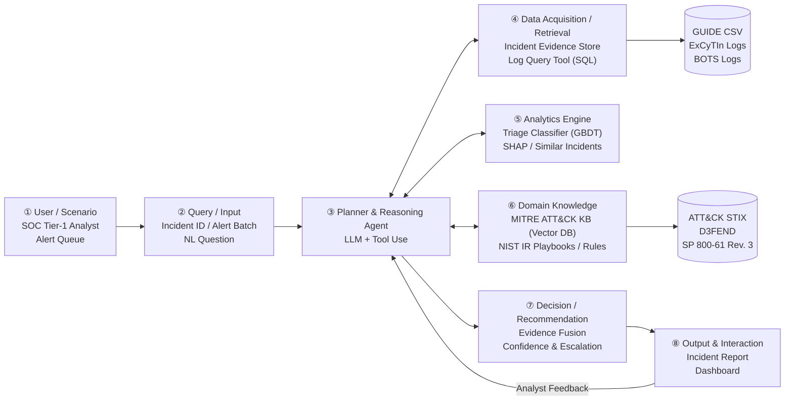

# Design: 01-proposal-workflow-refactor

## Context

Security Operations Centers (SOCs) operate under acute alert overload. Tier-1 analysts process thousands of alerts generated by EDR, SIEM, and firewall sensors daily. Over 70% of these alerts turn out to be false alarms or benign policy triggers (Benign Positives), inducing cognitive fatigue that risks missing critical breaches.

Existing approaches present significant limitations:
1. **Pure Tabular ML (e.g., GBDT, Microsoft CGR)**: Scales effectively to millions of records, but yields black-box probability predictions devoid of attack-chain narrative or multi-hop forensic context.
2. **Pure LLM Agents (e.g., AIDA, CORTEX)**: Exhibit reasoning and explanatory power, but benchmarks reveal that standard tool-using LLMs miss over 40.4% of attack alerts and suffer from premature closure when log queries return empty sets.
3. **Domain Knowledge Isolation**: Frameworks like MITRE ATT&CK and NIST SP 800-61 Rev. 3 playbooks are manually referenced by analysts rather than embedded as operational runtime constraints.

To address these deficits, this design converts the system architecture from `DESIGN.md` into a formal, verifiable Spec-Driven Development workflow within OpenSpec.

## Goals / Non-Goals

### Goals
- **G1**: Unify tabular ML efficiency (LightGBM on GUIDE) with LLM investigative reasoning (ReAct agent) via a calibrated evidence fusion layer.
- **G2**: Embed MITRE ATT&CK Tactics/Techniques as vector-retrieved domain knowledge and hard Kill Chain constraints (Rules R1~R5).
- **G3**: Quantify the trade-off between True Positive (TP) Miss Rate and Human Escalation Rate, providing tunable operational thresholds.
- **G4**: Enforce the **Assume Breach** principle: empty query results trigger investigative expansion or escalation rather than immediate case closure.
- **G5**: Produce dual-format auditable triage reports (JSON and Markdown) containing SHAP explanations, ATT&CK alignments, and evidence citations.

### Non-Goals
- **NG1 Autonomous Remediation**: The agent does not execute destructive containment actions (e.g., formatting machines or blackholing BGP routes) autonomously; all critical interventions require human sign-off.
- **NG2 Real-time Packet Deep Inspection**: The system operates at the incident, alert, and log event abstraction level, not on raw packet captures (PCAP).
- **NG3 Proprietary Model Dependency**: The architecture is designed to support local open-weights LLMs (e.g., Llama 3, Qwen 2.5) alongside frontier API models without architectural modifications.

## Decisions

### D1: Modular Eight-Component Architecture



- **Rationale**: Decoupling the Planner (③) from specialized engines (④ Data, ⑤ ML, ⑥ Knowledge) ensures testability, prevents context window explosion, and enables isolated evaluation on benchmark datasets.

### D2: Dynamic Planner Execution & Decision Tree

Instead of static linear pipelines, the Planner dynamically branches based on intermediate findings:

| Decision Point | Trigger / Condition | Chosen Execution Path |
|---|---|---|
| **Data Source Selection** | Input type is `IncidentId` vs. natural language | `IncidentId` routes to Evidence Store (DuckDB); NL queries invoke SQL generator on ExCyTIn logs |
| **Query Expansion Direction** | Missing entity context in $IsSufficient(E)$ | Missing user context → Query Auth logs; Missing host context → Query Sysmon process/network logs; Empty log result → Verify sensor health |
| **Scope Expansion** | ATT&CK Kill Chain stage detected | If Lateral Movement detected → expand scope to adjacent target workstations and domain controllers |
| **Termination Condition** | $IsSufficient(E) = True$ or calls $\ge B$ | If sufficient → proceed to ML & Fusion; If budget exhausted while ambiguous → mark `insufficient_evidence` and escalate |

### D3: Deterministic Kill Chain High-Risk Rules (`Rules(T)`)

| Rule | Condition within Incident | Operational Security Rationale |
|---|---|---|
| **R1 Late Kill Chain** | `Exfiltration` or `Impact` tactics present, or `Category == Ransomware` | Potential data theft or system destruction in progress; autonomous closure forbidden |
| **R2 Credential + Lateral** | `Credential Access` AND `Lateral Movement` present | Attacker has obtained credentials and is traversing the enterprise perimeter |
| **R3 Post-Compromise Foothold** | `Initial Access` AND (`Execution` OR `Persistence` OR `Privilege Escalation`) | Attack successfully transitioned from entry barrier to active host compromise |
| **R4 Anti-Forensics / Evasion** | Presence of T1070 (Indicator Removal, log tampering) | Log deletion indicates active cover-up; "no logs found" is treated as an active threat |
| **R5 Multi-Stage Progression** | Covers $\ge 4$ distinct ATT&CK Tactics | Highly unlikely to be an isolated benign trigger or false positive |

### D4: Algorithmic Specification

#### Algorithm 1: SOC Triage Agent Execution Workflow

```text
Algorithm 1: SOC Triage Agent Workflow
Input : Incident request Q (incident ID, alert batch, or NL question)
        Triage model M, ATT&CK knowledge base KB, playbook set PB
        Confidence threshold τ, tool-call budget B
Output: Triage report R

01: req ← ValidateAndParse(Q)
02: if req is invalid then return ErrorReport("missing or malformed input")
03: plan ← Planner.Decompose(req)
04: E ← ∅ ; calls ← 0
05: repeat
06:     tool ← Planner.SelectTool(plan, E)
07:     E ← E ∪ tool.Execute(req, E)
08:     calls ← calls + 1
09: until Planner.IsSufficient(E) or calls ≥ B
10: x ← ExtractFeatures(E)
11: p_ml ← M.PredictProba(x)                      ▷ p_ml = (p_TP, p_BP, p_FP)
12: φ ← SHAP(M, x)                                ▷ feature importance vector
13: S ← RetrieveSimilarIncidents(x, k)
14: T ← MapToMitreAttack(E, KB)                   ▷ Tactics, Techniques, Stages
15: p_llm, reasoning ← Planner.Reason(E, p_ml, φ, T, S)
16: verdict, conf, escalate, actions ← EvidenceFusion(p_ml, p_llm, T, E, PB, τ)
17: R ← GenerateReport(verdict, conf, escalate, φ, S, T, actions, reasoning, E)
18: return R
```

#### Algorithm 2: Evidence Fusion and Escalation Decision Logic

```text
Algorithm 2: Evidence Fusion & Escalation
Input : ML probabilities p_ml, LLM probabilities p_llm, ATT&CK tactics T
        Evidence set E, Playbook set PB, Threshold τ, Weights w_ml, w_llm
Output: (verdict, confidence, needs_human_review, recommended_actions)

01: p_fused ← w_ml * p_ml + w_llm * p_llm
02: verdict ← argmax(p_fused)
03: conf ← max(p_fused)
04: high_risk ← EvaluateRules(T)                  ▷ Rules R1 to R5
05: conflict ← (argmax(p_ml) ≠ argmax(p_llm))
06: insufficient ← (not Planner.IsSufficient(E))
07: if (conf < τ) or conflict or high_risk or insufficient then
08:     needs_human_review ← True
09: else
10:     needs_human_review ← False
11: end if
12: actions ← SelectPlaybookActions(verdict, T, PB)
13: return (verdict, conf, needs_human_review, actions)
```

## Risks / Trade-offs

| Risk / Trade-off | Consequence | Mitigation Strategy |
|---|---|---|
| **TP Miss Rate vs. Escalation Rate** | Escalating 100% of alerts achieves 0% miss rate but overwhelms SOC analysts; escalating 0% risks catastrophic compromise. | Characterize Pareto frontier on validation sets; allow SOC managers to set threshold $\tau$ based on available Tier-1 analyst shifts. |
| **Statistical ML vs. LLM Context** | GBDT is computationally lightweight ($<10$ ms) but context-blind; LLMs provide deep narrative but add latency (2–8 s) and cost. | GBDT acts as fast baseline filter; LLM acts as reasoning aggregator and investigator, bounded by strict token budgets. |
| **Rule Rigidity vs. Agent Flexibility** | Strict rules (R1~R5) may escalate benign stress tests or internal red teaming. | Rules flag `needs_human_review` rather than hardcoding a destructive response, allowing human analysts to annotate benign exceptions. |
